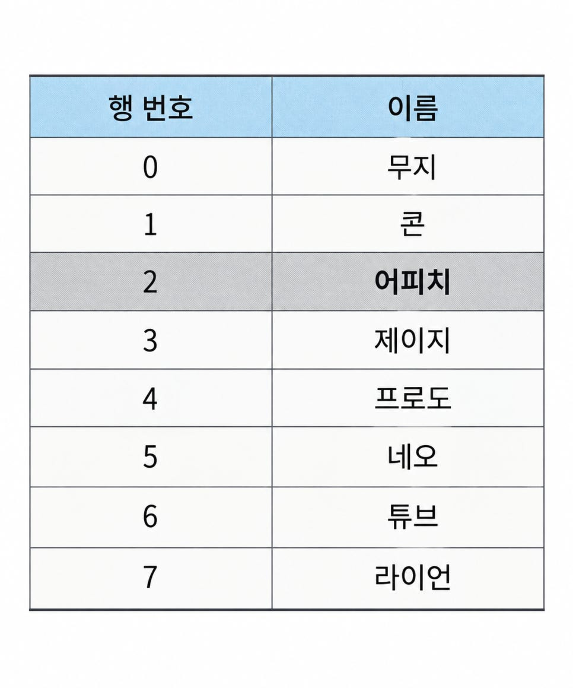
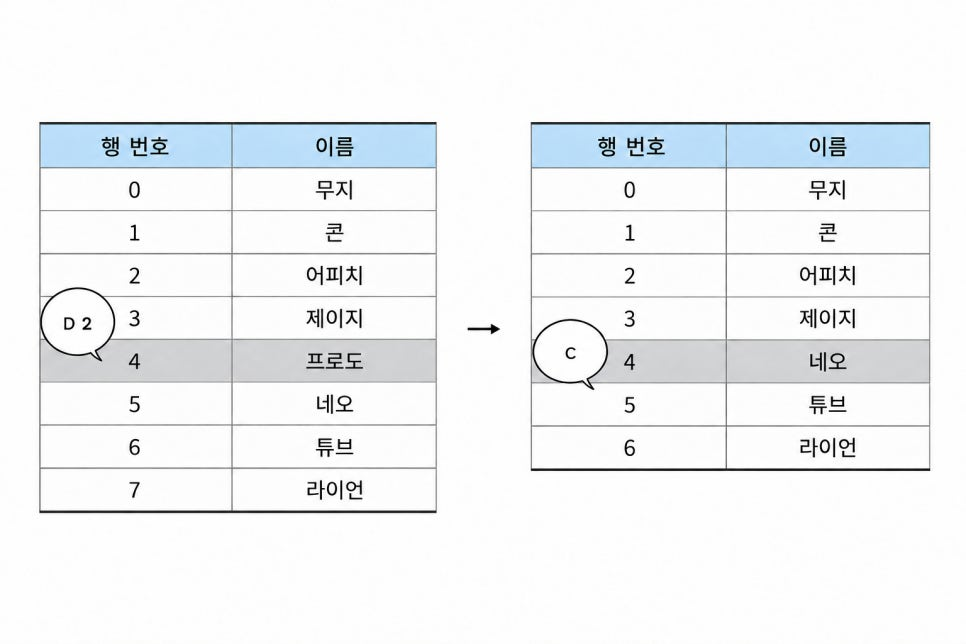
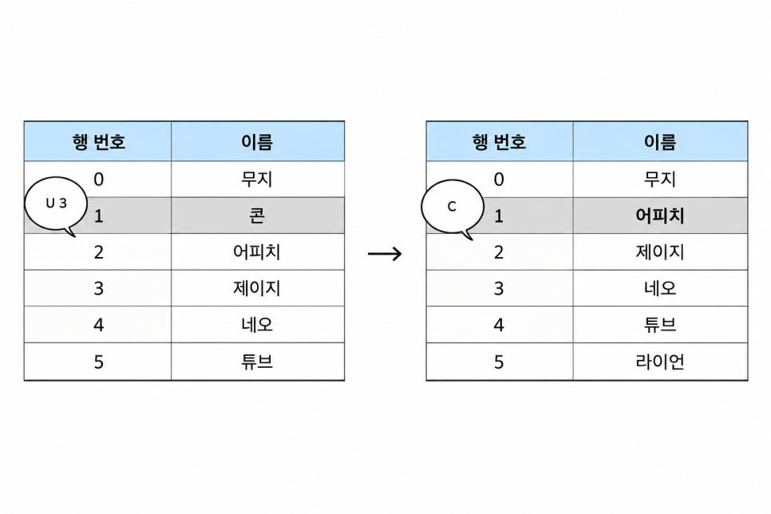
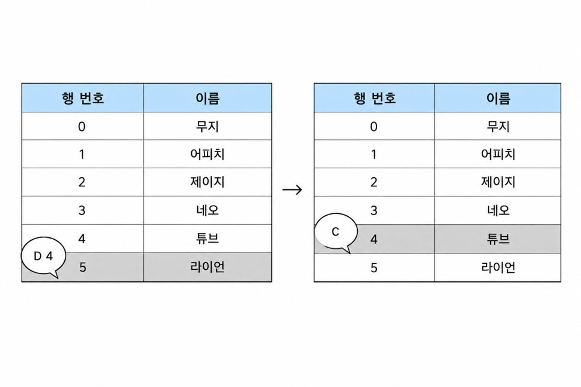
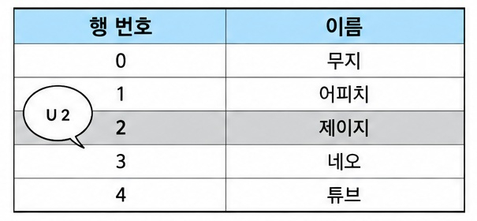
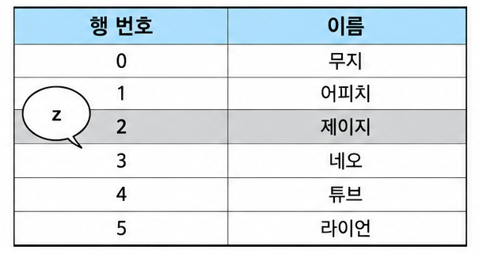
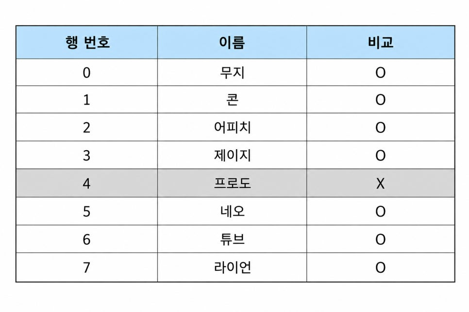
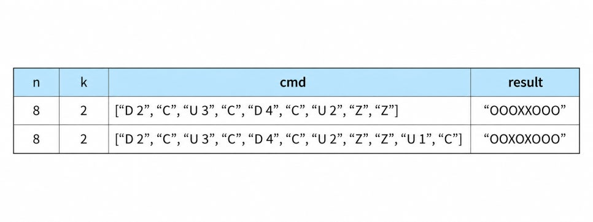

# \[PCCP 준비\] 문제 14. 표 편집 — 스택과 이중 연결 리스트의 이해

**문제 14 표 편집**

업무용 소프트웨어를 개발하는 나니즈웍스의 인턴인 앙몬드는 명령어 기반으로 표의 행을 선택, 삭제, 복구하는 프로그램을 작성하는 과제를 맡았습니다. 세부 요구사항은 다음과 같습니다.



AI 활용

표에서 진하게 칠한 칸은 선택한 행입니다. 한 번에 한 행만 선택할 수 있으며 표의 범위를 벗어날 수 없습니다. 이때 다음과 같은 명령어를 이용해 표를 편집합니다.

"U X": 현재 선택한 행에서 X칸 위에 있는 행을 선택합니다.

"D X": 현재 선택한 행에서 X칸 아래에 있는 행을 선택합니다.

"C": 현재 선택한 행을 삭제한 후, 바로 아래 행을 선택합니다. 단, 삭제된 행이 가장 마지막 행인 경우 바로 윗 행을 선택합니다.

"Z": 가장 최근에 삭제한 행을 원래대로 복구합니다. 단, 현재 선택한 행은 바뀌지 않습니다.

예를 들어 위 표에서 "D 2"를 수행하면 다음 그림의 왼쪽처럼 4행이 선택되며 "C"를 수행하면 선택된 행을 삭제하고 바로 아래 행이었던 "네오"가 적힌 행을 선택합니다.



다시 "U 3"을 수행한 다음 "C"를 수행한 후의 표 상태는 다음 그림과 같습니다.



다음으로 "D 4"를 수행한 다음 "C"를 수행한 후의 표 상태는 다음 그림과 같습니다. 5행이 표의 마지막 행이므로, 이 경우 바로 윗 행을 선택하는 점에 주의합니다.



AI 활용

"U 2"를 수행하면 현재 선택한 행은 2행이 됩니다.



위 상태에서 "Z"를 수행하면 가장 최근에 제거한 "라이언"이 적힌 행이 복구됩니다.



다시 한번 "Z"를 수행하면 그 다음으로 제거한 "콘"이 적힌 행이 복구됩니다. 현재 선택된 행은 바뀌지 않으는 점에 주의하세요.

최종 표의 상태와 처음 표의 상태를 비교해 삭제되지 않은 행은 "O", 삭제된 행은 "X"로 표시하면 다음과 같습니다.



처음 표의 행 개수를 나타내는 정수 n, 처음에 선택한 행의 위치를 나타내는 정수 k, 수행한 명령어들이 담긴 문자열 배열 cmd가 주어질 때, 모든 명령어를 수행한 후의 표의 상태와 처음 표의 상태를 비교해 삭제되지 않은 행은 O, 삭제된 행은 X로 표시해 문자열 형태로 반환하는 solution() 함수를 완성하세요.

**제약 조건**

- 5 ≤ n ≤ 1,000,000

- 0 ≤ k &lt; n

- 1 &lt; 층의 원소 개수 ≤ 200,000

- cmd의 각 원소는 "U X", "D X", "C", "Z" 중 하나입니다.

- X는 1 이상 300,000 이하인 자연수이며 0으로 시작하지 않습니다.

- X가 나타내는 자연수에 쉼표는 없습니다. 예를 들어 123,456이 아니라 123456과 같이 자연수가 주어집니다.

- cmd에 등장하는 모든 X들의 값을 합친 결과가 1,000,000 이하인 경우만 입력으로 주어집니다.

- 표의 모든 행을 제거해 행이 하나도 남지 않는 경우는 입력으로 주어지지 않습니다.

- 문제에서 각 행이 제거되고 복구되는 과정을 자연스럽게 보여주기 위해 "이름"이라는 열을 사용했으나, 실제 문제를 푸는 과정에는 필요하지 않습니다. "이름" 열에는 서로 다른 이름들이 중복 없이 채워져 있다고 가정하고 문제를 해결하세요.

표의 범위를 벗어나는 이동은 입력으로 주어지지 않습니다.

원래대로 복구할 행이 없을 때, 즉, 삭제한 행이 없을 때 "Z"가 명령어로 주어지는 경우는 없습니다.

정답은 표의 0행부터 n - 1행까지에 해당되는 O, X를 순서대로 이어붙인 문자열 형태로 반환해주세요.

**정확성 테스트 케이스 제약 조건**

정확성 테스트: 10초

5 ≤ n ≤ 1,000

1 ≤ cmd의 원소 개수 ≤ 1,000

**효율성 테스트 케이스 제약 조건**

효율성 테스트: 언어별로 작성된 정답 코드의 실행 시간의 적정 배수

주어진 조건 외 추가 제약 조건 없습니다.

**입출력의 예**



## 1. 문제 개요

이번에 학습한 문제는 박경록 저 『코딩 테스트 합격자 되기』 문제 14 「표 편집」이며, 해당 문제는 2021 카카오 채택연계형 인턴십에 출제되었다. 이번 문제는 표에서 현재 선택된 행을 위아래로 이동하거나 삭제하고, 삭제한 행을 복원하는 문제다. 모든 명령어를 실행한 후 각 행의 삭제 여부를 O와 X로 표시해야 한다. 명령어는 네 가지다.

| **명령어** | **기능** |
| --- | --- |
| U X | 현재 행에서 X칸 위로 이동 |
| D X | 현재 행에서 X칸 아래로 이동 |
| C | 현재 선택된 행 삭제 |
| Z | 가장 최근에 삭제한 행 복원 |

처음에는 스택을 활용한 문제라고 생각했지만, 실제로는 스택과 이중 연결 리스트를 결합한 문제였다.

알고리즘의 접근 방식 자체가 지나치게 어렵지는 않았다. 다만 코드 한 줄에 여러 인덱스 접근과 연결 관계의 변경이 압축되어 있어, 각 연산을 정확히 이해하는 데 상당한 시간이 필요했다.

## 2. 핵심 자료구조

### 2.1 스택: deleted

```python
deleted = []
```

`deleted`는 삭제된 행의 **인덱스**를 저장하는 스택이다.

```python
deleted.append(k)
restore = deleted.pop()
```

- `append(k)` : 현재 선택된 행의 인덱스를 저장한다.

- `pop()` : 가장 최근에 삭제한 행의 인덱스를 꺼낸다.

예를 들어 다음과 같다면,

```python
deleted = [2, 4, 3]
restore = deleted.pop()
```

결과는 다음과 같다.

```python
restore = 3
deleted = [2, 4]
```

여기서 중요한 사실은 `deleted`가 행의 데이터나 연결 정보를 저장하는 것이 아니라, 삭제된 행의 인덱스만 저장한다는 점이다.

삭제된 행의 위아래 연결 정보는 `up`, `down` 배열에 그대로 남아 있으므로, 복원할 때 해당 인덱스를 통해 다시 접근할 수 있다.

### 2.2 이중 연결 리스트: up과 down

```python
up = [i - 1 for i in range(n + 2)]
down = [i + 1 for i in range(n + 1)]
```

- `up[k]` : k번 행의 바로 위에 연결된 행의 인덱스

- `down[k]` : k번 행의 바로 아래에 연결된 행의 인덱스

행을 실제로 삭제하거나 배열의 원소를 이동시키는 대신, 인덱스 간의 연결 관계를 변경한다.

이 방법을 사용하면 행을 삭제하거나 복원할 때 배열의 나머지 원소를 이동시킬 필요가 없다.

## 3. up은 n+2, down은 n+1인 이유

이 부분을 이해하는 데 시간이 걸렸다.

```python
up = [i - 1 for i in range(n + 2)]
down = [i + 1 for i in range(n + 1)]
```

`n = 5`라고 가정하면 다음과 같다.

```python
up = [-1, 0, 1, 2, 3, 4, 5]
down = [1, 2, 3, 4, 5, 6]
```

### 3.1 range(7)의 의미

```python
range(7)
# 0, 1, 2, 3, 4, 5, 6
```

`range(7)`은 0부터 6까지 총 7개의 정수를 생성한다.

따라서 `up` 배열에는 인덱스 0부터 6까지 존재한다.

| **인덱스** | **up의 값** | **down의 값** |
| --- | --- | --- |
| 0 | -1 | 1 |
| 1 | 0 | 2 |
| 2 | 1 | 3 |
| 3 | 2 | 4 |
| 4 | 3 | 5 |
| 5 | 4 | 6 |
| 6 | 5 | 없음 |

여기서 구분해야 할 것은 **배열의 인덱스와 배열에 저장된 값**이다.

`up` 배열의 마지막 값은 5이지만, 마지막 인덱스는 6이다.

### 3.2 실제 행과 가상 행

이 풀이에서는 실제 행 외에 양쪽 경계를 나타내는 가상 행을 사용한다.

```python
k += 1
```

원래 0부터 시작하는 행 번호를 내부적으로 1부터 시작하도록 변경한다.

`n = 5`라면 다음과 같다.

| **내부 인덱스** | **의미** |
| --- | --- |
| 0 | 맨 위 가상 행 |
| 1 | 실제 0번 행 |
| 2 | 실제 1번 행 |
| 3 | 실제 2번 행 |
| 4 | 실제 3번 행 |
| 5 | 실제 4번 행 |
| 6 | 맨 아래 가상 행 |

실제 행은 1~5번이고, 0번과 6번은 경계 처리를 위한 가상 행이다.

### 3.3 up에 n+2가 필요한 이유

맨 아래 실제 행인 5번을 삭제하는 경우를 살펴보자.

```python
up[down[5]] = up[5]
```

초기 배열에서

```python
down[5] = 6
up[5] = 4
```

이므로 다음과 같이 계산된다.

```python
up[6] = 4
```

따라서 `up`에는 인덱스 6까지 접근할 수 있는 공간이 필요하다.

반면 `down`은 0번부터 5번까지의 인덱스만 사용하면 된다.

```python
down[up[1]] = down[1]
```

맨 위 실제 행인 1번을 삭제할 때는 다음과 같다.

```python
down[0] = 2
```

결국 `up`은 맨 아래 가상 행의 연결 정보까지 갱신해야 하지만, `down`은 맨 아래 가상 행의 아래쪽 연결 정보를 갱신할 필요가 없다.

따라서 다음과 같이 배열 길이를 다르게 설정한다.

```python
up   # n + 2개
down # n + 1개
```

물론 `down`도 `n + 2`개로 만들 수 있지만, 마지막 공간은 사용하지 않는다.

## 4. 삭제 연산: C

```python
if cmd_i.startswith("C"):
    deleted.append(k)
    up[down[k]] = up[k]
    down[up[k]] = down[k]
    k = up[k] if n < down[k] else down[k]
```

### 4.1 startswith()

```python
cmd_i.startswith("C")
```

문자열이 `"C"`로 시작하는지 확인한다.

결과는 `True` 또는 `False`이다.

이 문제에서는 `C`가 단독 명령어이므로 다음과 같이 작성해도 된다.

```python
cmd_i == "C"
```

### 4.2 삭제된 행의 인덱스 저장

```python
deleted.append(k)
```

현재 선택된 행의 인덱스를 스택에 저장한다.

### 4.3 아래쪽 행의 위 연결 변경

```python
up[down[k]] = up[k]
```

이 코드는 중첩 인덱싱 때문에 처음에는 이해하기 어려웠다.

`k = 3`이라고 가정하면,

```python
down[3] = 4
up[3] = 2
```

따라서

```python
up[4] = 2
```

가 된다.

3번 행을 삭제하므로, 4번 행의 위쪽 연결을 3번에서 2번으로 변경하는 것이다.

코드를 분해하면 다음과 같다.

```python
below = down[k]
above = up[k]

up[below] = above
```

### 4.4 위쪽 행의 아래 연결 변경

```python
down[up[k]] = down[k]
```

마찬가지로 `k = 3`을 대입하면

```python
up[3] = 2
down[3] = 4
```

이므로

```python
down[2] = 4
```

가 된다.

즉, 2번 행의 아래쪽 연결을 3번에서 4번으로 변경한다.

두 연산을 합치면 다음과 같다.

삭제 전:

```text
2 ↔ 3 ↔ 4
```

삭제 후:

```text
2 ↔ 4

3번 행의 기존 연결 정보는 유지
```

핵심은 **삭제된 행을 배열에서 제거하는 것이 아니라, 양쪽 행이 삭제된 행을 건너뛰도록 연결한다는 것**이다.

### 4.5 삭제 후 선택 위치 변경

```python
k = up[k] if n < down[k] else down[k]
```

조건부 표현식이다.

일반적인 `if`문으로 작성하면 다음과 같다.

```python
if n < down[k]:
    k = up[k]
else:
    k = down[k]
```

삭제한 행 아래에 실제 행이 있다면 아래쪽 행을 선택한다.

반면 아래쪽이 가상 행이라면 위쪽 행을 선택한다.

예를 들어 `n = 5`, `k = 5`라면

```python
down[5] = 6
```

이므로

```python
5 < 6  # True
```

가 된다.

따라서 현재 선택 위치는 위쪽 행으로 이동한다.

## 5. 복원 연산: Z

```python
elif cmd_i.startswith("Z"):
    restore = deleted.pop()
    down[up[restore]] = restore
    up[down[restore]] = restore
```

### 5.1 restore의 역할

`restore`는 복원할 행의 인덱스를 저장하는 변수이다.

```python
restore = deleted.pop()
```

예를 들어

```python
deleted = [3]
```

이라면

```python
restore = 3
deleted = []
```

이 된다.

### 5.2 위쪽 행의 아래 연결 복원

```python
down[up[restore]] = restore
```

`restore = 3`이라면

```python
down[up[3]] = 3
```

삭제 전 연결 정보가

```python
up[3] = 2
```

였으므로

```python
down[2] = 3
```

이 된다.

2번 행의 아래쪽에 3번 행을 다시 연결하는 것이다.

### 5.3 아래쪽 행의 위 연결 복원

```python
up[down[restore]] = restore
```

마찬가지로

```python
up[down[3]] = 3
```

이고,

```python
down[3] = 4
```

이므로

```python
up[4] = 3
```

이 된다.

결과적으로 연결 관계는 다음과 같이 복원된다.

```text
2 ↔ 3 ↔ 4
```

복원 코드를 분해하면 다음과 같다.

```python
restore = deleted.pop()

above = up[restore]
below = down[restore]

down[above] = restore
up[below] = restore
```

`restore`는 행을 새로 생성하는 변수가 아니다. 삭제된 행의 인덱스를 이용해 기존 연결 관계를 복구하는 변수이다.

또한 복원 명령은 현재 선택된 행을 나타내는 `k`를 변경하지 않는다.

## 6. 이동 연산: U와 D

```python
else:
    action, num = cmd_i.split()

    if action == "U":
        for _ in range(int(num)):
            k = up[k]
    else:
        for _ in range(int(num)):
            k = down[k]
```

### 6.1 split()

```python
action, num = cmd_i.split()
```

문자열을 공백을 기준으로 나누는 메서드이다.

```python
cmd_i = "U 2"

cmd_i.split()
# ["U", "2"]
```

결과를 두 변수에 할당한다.

```python
action = "U"
num = "2"
```

이 과정을 언패킹이라고 한다.

`num`은 문자열이므로 반복 횟수로 사용하기 위해 `int()`로 정수 변환한다.

### 6.2 U: 위로 이동

```python
for _ in range(int(num)):
    k = up[k]
```

`U 2`라면 `up[k]`를 두 번 따라간다.

### 6.3 D: 아래로 이동

```python
for _ in range(int(num)):
    k = down[k]
```

`D 2`라면 `down[k]`를 두 번 따라간다.

여기서 중요한 점은 `k += 1`, `k -= 1`로 이동하지 않는다는 것이다.

삭제된 행이 존재할 수 있으므로, 단순히 인덱스를 증가시키거나 감소시키면 삭제된 행을 선택할 위험이 있다.

따라서 현재 연결된 행의 인덱스를 이용해 이동한다.

## 7. 결과 생성

```python
answer = ["O"] * n

for i in deleted:
    answer[i - 1] = "X"

return "".join(answer)
```

### 7.1 O로 초기화

```python
answer = ["O"] * n
```

모든 행이 남아 있다고 가정하고 `O`를 저장한다.

### 7.2 삭제된 행은 X로 변경

```python
for i in deleted:
    answer[i - 1] = "X"
```

`deleted`에 남아 있는 인덱스는 최종적으로 복원되지 않은 행이다.

여기서 `i - 1`을 사용하는 이유는 앞에서 `k += 1`을 통해 실제 행의 내부 인덱스를 하나 증가시켰기 때문이다.

결과를 만들 때는 원래 행 번호에 맞춰 다시 1을 빼야 한다.

### 7.3 join()

```python
return "".join(answer)
```

`join()`은 여러 문자열을 하나의 문자열로 연결한다.

```python
answer = ["O", "X", "O", "O", "X"]

"".join(answer)
# "OXOOX"
```

`""`는 원소 사이에 아무 문자도 넣지 않겠다는 의미이다.

`split()`이 문자열을 나누는 기능이라면, `join()`은 문자열을 연결하는 기능이다.

## 8. 시간 복잡도

이 풀이에서 삭제와 복원은 각각 연결 정보 몇 개만 변경하므로 O(1)에 수행된다.

위아래 이동은 명령어에 지정된 칸 수만큼 연결을 따라가므로 O(X)가 필요하다.

전체 시간 복잡도는 다음과 같이 표현할 수 있다.

**O(n + m + S)**

- `n` : 초기 표의 행 개수

- `m` : 명령어 개수

- `S` : 모든 U, D 명령에서 실제 이동한 칸 수의 합

초기 배열 생성과 최종 결과 작성에 O(n), 명령어 처리에 O(m + S)가 필요하다.

공간 복잡도는 `up`, `down`, `deleted`, `answer`를 포함해 O(n)이다.

## 9. 이번 학습에서 이해한 핵심

이번 문제를 통해 다음 내용을 확인했다.

1. `deleted`는 삭제된 행의 데이터가 아니라 인덱스를 저장한다.

2. `up`, `down`은 각각 위쪽과 아래쪽에 연결된 행의 인덱스를 저장한다.

3. 실제 행과 가상 행의 인덱스를 구분해야 한다.

4. 리스트의 인덱스와 해당 인덱스에 저장된 값은 서로 다르다.

5. 삭제는 원소 제거가 아니라 연결 관계의 변경으로 구현할 수 있다.

6. 복원은 삭제된 행에 남아 있는 연결 정보를 이용한다.

7. 중첩 인덱싱은 여러 줄로 분해하면 연산 과정을 이해하기 쉽다.

특히 이번 문제에서 중요했던 것은 한 줄의 코드를 여러 단계의 연산으로 나누어 이해하는 과정이었다.

## 10. 학습 회고

이번 문제는 처음 읽은 다음 날부터 본격적으로 풀이를 분석했다.

첫 날 약 한 시간 동안 학습했지만, 독립적으로 코드를 구현할 수 있는 수준을 기준으로 하면 이해도는 20~30% 정도라고 판단했다.

다만 이는 문제의 개념을 20~30%만 이해했다는 의미는 아니다.

알고리즘의 접근 방식과 자료구조의 역할은 이해했지만, 코드를 보지 않고 처음부터 자연스럽게 구현하는 수준에는 아직 도달하지 못했다는 의미다.

이후 여러 차례 복습하면서 다음과 같은 의문을 해결했다.

· up과 down의 배열 길이가 다른 이유는 무엇인가?

· down\[5\] = 6에서 5와 6은 각각 무엇을 의미하는가?

· 실제 행과 가상 행은 어떻게 구분하는가?

· deleted에는 무엇을 저장하는가?

· restore는 어떤 정보를 이용해 삭제된 행을 복원하는가?

· split(), startswith(), join()은 각각 어떤 역할을 하는가?

처음에는 개별 코드의 의미를 확인하는 데 집중했지만, 복습하면서 배열의 구조와 인덱스 사이의 관계를 이해하는 방향으로 질문이 발전했다.

특히 deleted가 행의 인덱스를 저장한다는 사실과 실제 행·가상 행의 구분을 이해한 것이 중요한 진전이었다.

이 문제는 코드의 길이 자체보다 한 줄에 압축된 정보량이 많다는 점에서 어려웠다.

앞으로는 압축된 코드를 먼저 암기하기보다, 여러 변수로 분해해 연결 관계를 이해한 후 다시 간결한 코드로 작성하는 연습이 필요하다고 생각한다.

최종 목표는 해설을 보고 이해하는 것이 아니라, 문제를 읽고 스스로 자료구조를 선택해 구현할 수 있는 수준에 도달하는 것이다.

이번 학습은 그 목표를 향한 첫 번째 분석 과정이었다.
