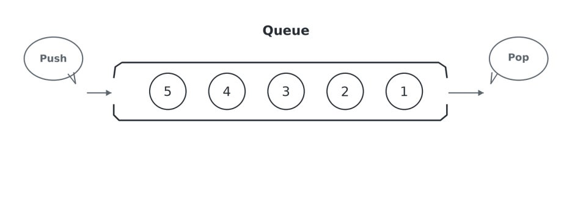
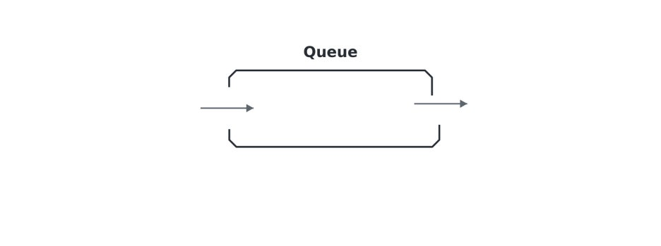
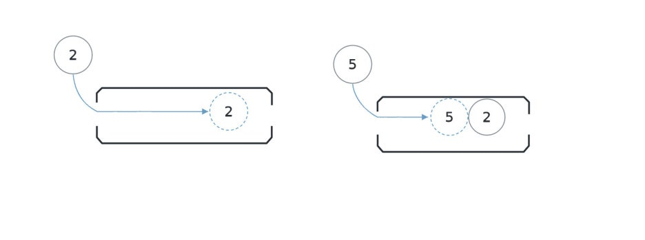
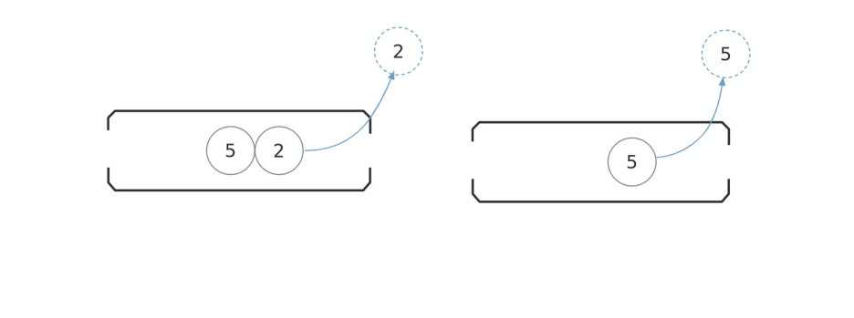
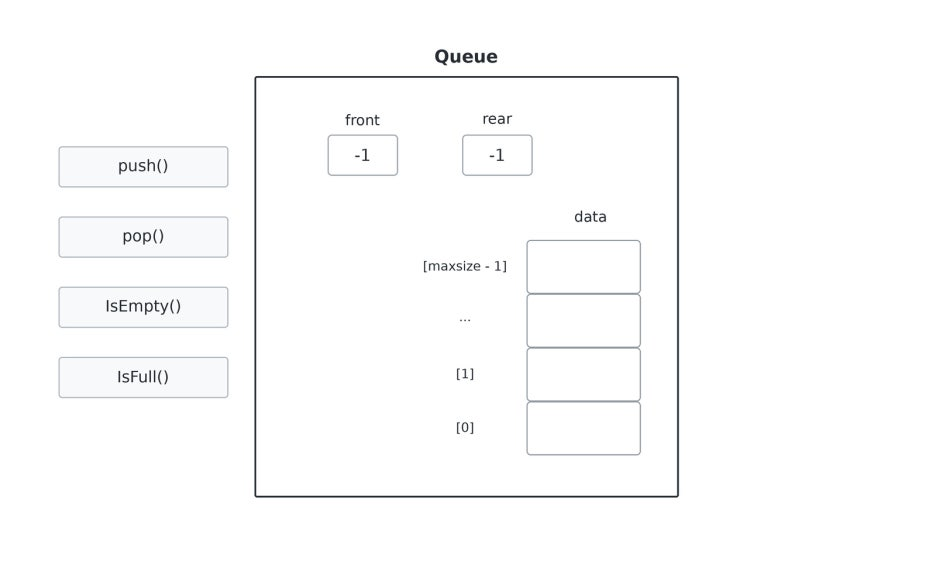
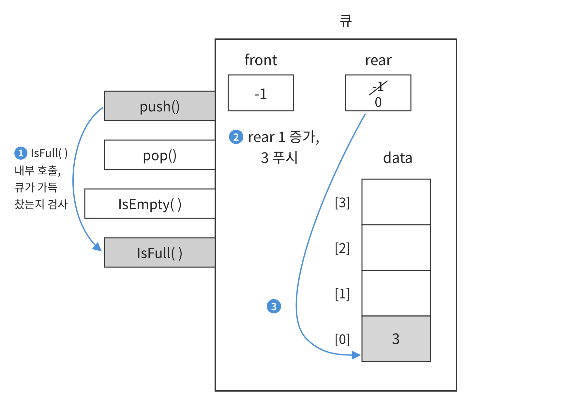
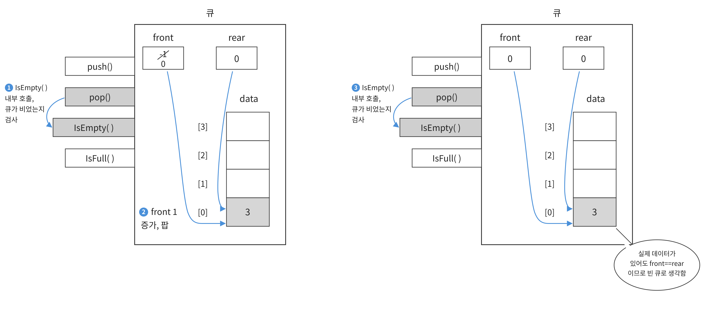
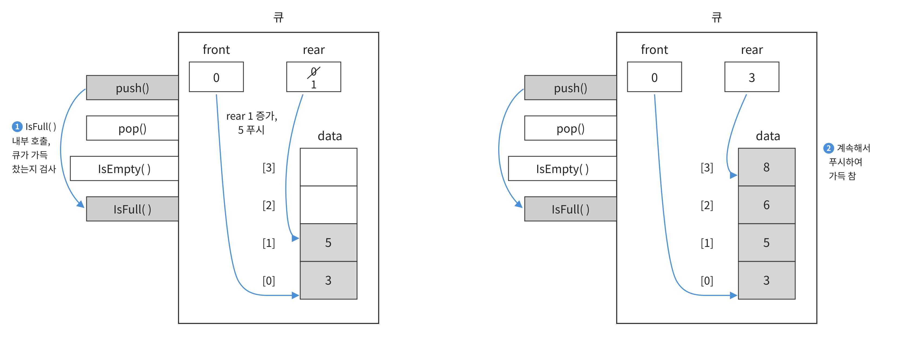
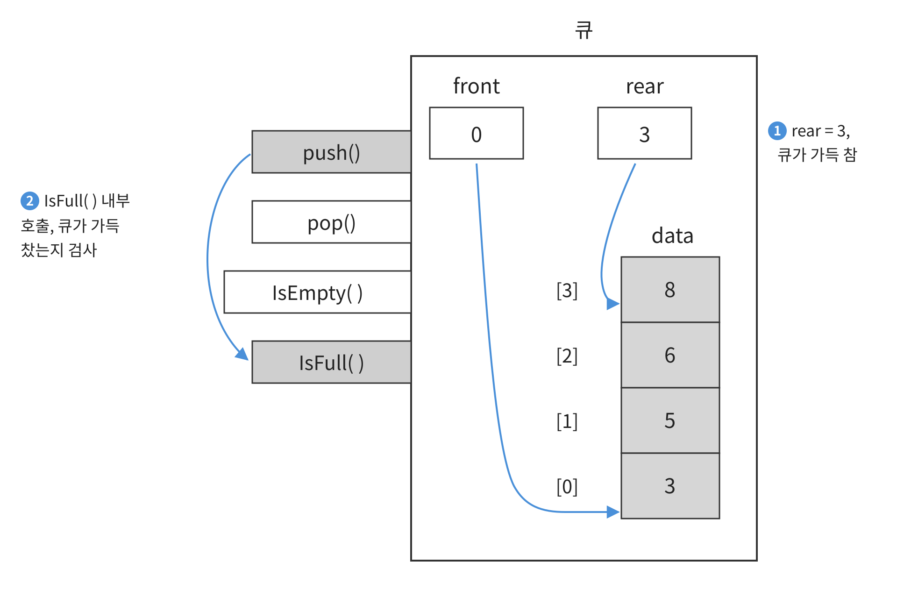
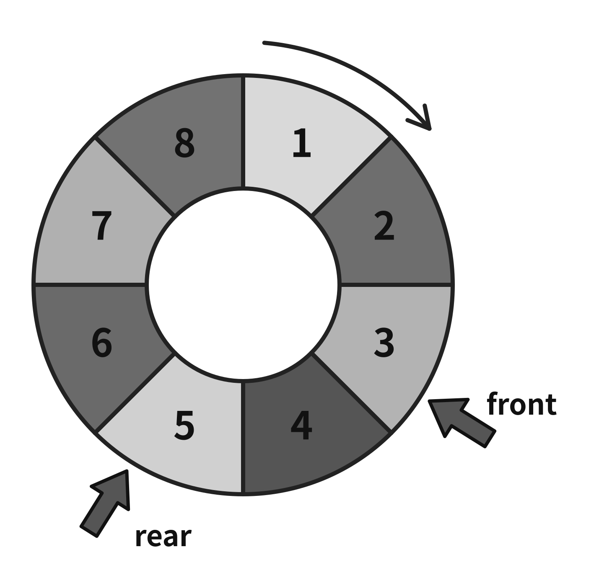

# PCCP 준비(5)

## 14주차 회고

8월에 시작한 부트 캠프가 어느덧 4개월차에 접어들고 있다. 11월 초임에도 겨울같은 가을을 보내며 두터운 옷들을 꺼내든다. 너무 덥지도 차갑지도 않은 온도에 파란 하늘 아래 색색의 화려한 잎들의 축제를 거닐 던 가을을 기억하고 있는 나는, 이번 가을이 낯설기만 하다. 가을은 독서의 계절이라지만 공부에 대한 에너지는 점차로 소진되고 있다. 주말 저녁, 의무감에 다시 책을 펼친다. 내가 계획한 일에 대해 책임을 지는 건 스스로에 대한 약속을 지키는 일이므로.

---

## 07 큐의 개념

> 📚 코딩 테스트 합격자 되기-파이썬 편, 박경록, GOLDEN RABBIT, 2024

큐는 '줄을 서다'라는 뜻을 가지고 있다. 큐는 먼저 들어간 데이터가 먼저 나오는 자료구조이다. 역시 스택과 마찬가지로 생활 속에서 쉽게 예를 찾아볼 수 있다. 맛집에서 줄을 선 순서대로 식당에 입장할 때를 생각해보면 된다. 먼저 줄을 선 사람이 먼저 입장한다. 이런 큐의 특징을 **선입선출** 또는 **FIFO**라고 한다. 그리고 스택과 마찬가지로 큐도 삽입하는 연산을 **푸시**, 꺼내는 연산을 **팝**이라고 한다.



### 큐에서 데이터가 이동하는 과정 살펴보기

그림을 통해 큐에서 원소가 이동하는 과정을 이해한다.

**01단계** 빈 큐를 하나 선언한다.



**02단계** 원소를 삽입한다. 빈 큐이므로 제일 앞에 삽입한다. 이어서 5를 삽입한다. 5는 2 다음으로 삽입했으니 2보다는 뒤에 있다.



**03단계** 팝을 하면 5가 아니라 2가 먼저 나온다. 이어서 팝을 한 번 더 진행하면 5가 빠져나온다.



### 큐의 특성을 활용하는 분야

먼저 들어온 것을 먼저 처리하는 큐의 동작 방식은 프로그래밍 언어에서 많이 활용되고 있다. 대표적으로 여러 이벤트가 발생했을 때 발생한 순서대로 처리할 때 큐가 활용된다. 실생활에서도 큐의 특성은 자연스럽게 사용되고 있다. 영화관에서 줄을 서는 사람들을 처리해야 할 때 먼저 줄을 선 사람을 먼저 처리하는 것이 그 예이다. 그 밖의 큐의 특성을 활용하는 분야는 다음과 같다.

- **작업 대기열**: 네트워크 통신을 할 때 다수의 클라이언트에서 서버에 작업을 요청하면 서버는 요청이 들어온 순서대로 작업을 처리한다. 이때 큐를 활용할 수 있다.
- **이벤트 처리**: 어떤 애플리케이션이나 시스템에서 사용자의 이벤트, 예를 들어 키보드 입력이나 마우스 움직임을 처리할 때 큐를 활용할 수 있다.

### 큐의 ADT

여기서도 스택과 마찬가지로 큐의 ADT를 정의해보고 큐가 실제로 동작하는 원리를 살펴본다.

큐의 ADT는 다음과 같다. 여기서도 표와 그림으로 설명하겠다.

| 구분 | 정의 | 설명 |
|------|------|------|
| 연산 | `boolean isFull()` | 큐에 들어 있는 데이터 개수가 maxsize인지 확인해 boolean값을 반환한다. |
| | `boolean isEmpty()` | 큐에 들어 있는 데이터가 하나도 없는지 확인해 boolean 값을 반환한다. |
| | `void push(itemType item)` | 큐에 데이터를 푸시한다. |
| | `itemType pop()` | 큐에서 처음에 푸시한 데이터를 팝하고, 그 데이터를 반환한다. |
| 상태 | `int front` | 큐에서 다음에 제거할 원소의 위치를 기록한다. |
| | `int rear` | 큐에서 최근에 푸시한 데이터의 위치를 기록한다. |
| | `itemType data[maxsize]` | 큐의 데이터를 관리하는 배열이다. 최대 maxsize개의 데이터를 관리한다. |



그림은 큐의 ADT를 나타낸 것이다. 큐의 외부와 내부에 네모 모양으로 표현한 연산과 데이터 상태가 보인다. 이 그림은 스택에서 제시했던 그림이므로 쉽게 이해할 수 있다. 달라진 점은 스택의 top이 front와 rear로 바뀐 것이다. 스택은 FILO이다. 따라서 배열로 구현 시 뒤에 있는 원소를 팝하면 되므로 top만 있으면 구현할 수 있다. 하지만 큐는 FIFO이므로 이를 배열로 구현하려면 배열의 앞 뒤를 표시할 변수가 필요하므로 front와 rear가 필요하다. 지금의 경우 아무런 데이터도 넣은 상태가 아니므로 front와 rear 모두 -1이다.

> ※ 배열의 인덱스는 0부터 시작하므로 아무것도 넣지 않은 상황을 표현하기 위해 초깃값을 -1로 했다.

### 큐의 세부 동작에 대해 조금 더 자세히 알아보기

구체적인 예와 함께 큐에서 연산이 수행되면 어떻게 되는지 알아보자.

**01단계** 다음은 `isFull()` 연산으로 ① 현재 큐가 가득 찼는지 확인하고 큐가 가득 차지 않았으므로 (`isFull`이 False) ② rear를 +1한 다음 rear가 가리키는 위치에 ③ 3을 푸시하는 모습이다.

> ※ 반대로 `isFull` 연산이 True이면 데이터를 푸시하지 않는다.



**02단계** 이 상태에서 팝을 하면 어떻게 될까? ① 우선 `isEmpty()` 연산을 통해 큐가 비었는지 확인한다. `isEmpty()` 연산은 front, rear의 값이 같은지 확인해서 큐에 원소가 없는데 팝하는 동작을 방지한다. ② 만약 비어 있지 않다면(`isEmpty`가 False) front를 +1한다. 이렇게 하면 front, rear가 0으로 같아지므로 ③ `isEmpty()` 연산 시 큐가 빈 것(`isEmpty()`가 True)으로 처리되어 실제 배열의 데이터를 삭제하지 않고도 데이터를 삭제한 것처럼 관리할 수 있다.



**03단계** 계속해서 푸시를 한다. ① 5를 푸시하면 `isFull()` 연산을 수행해 큐가 가득 찼는지 검사하고, 가득 차지 않았다면 푸시한다. ② 연거푸 6과 8을 푸시하면 다음과 같이 front는 0, rear는 3이다.



**04단계** 이제 큐가 가득 찼을 때 푸시하면 어떻게 되는지 보자. ① rear가 3이므로 maxsize - 1과 같다. 다시 말해 ② `isFull()` 연산은 True이므로 푸시하지 못한다.



큐가 가득 찬 상태에서 하나 생각해볼 내용이 있다. 마지막 푸시에서 실제 data에 저장한 데이터는 3, 5, 6, 8로 4개지만 큐는 5, 6, 8로 3개이다. 다시 말해 **큐는 front의 다음부터 rear까지를 큐가 관리하는 데이터로 생각해야 한다.** 그런데 가만히 생각해보면 실제 data의 공간은 4개인데 큐가 관리하는 데이터는 3개이므로 실질적으로는 메모리 공간을 낭비한 상황이다. 이렇게 된 이유는 큐를 한 방향으로 관리하고 있기 때문이다. 이렇게 하면 front 이전의 공간을 활용하지 못한다. 다시 말해 front 이전을 기준으로 큐의 사용할 수 있는 부분과, 사용할 수 없는 부분이 나뉘었다.

### 큐를 원형으로 개선하기

이를 개선하려면 책에서 설명한 형태의 큐가 아니라 다른 형태의 큐가 필요하다. 책에서 설명한 큐는 선형으로 구현한 큐이다. 선형 큐는 front와 rear가 한 방향으로 이동한다. 이를 개선한 큐는 **원형 큐**이다. 낭비하는 공간을 없애기 위해 원으로 front와 rear가 돈다. 원형 큐는 선형 큐보다 구현하기는 조금 복잡하지만 메모리 공간을 절약할 수 있다는 장점이 있다. 다만 코딩 테스트에서는 파이썬에서 제공하는 리스트를 사용해도 충분하다. 왜냐하면 파이썬에서는 리스트의 길이를 자동으로 관리하기 때문이다.

<p align="center"></p>

## 큐 구현하기

큐를 간단하게 구현하는 방식은 크게 2가지 방식이 있다. 첫 번째는 리스트를 활용하는 방식, 두 번째는 덱을 활용하는 방식이다.

### 리스트를 큐처럼 활용하기

리스트를 큐처럼 활용하는 방식부터 살펴본다. 푸시 연산은 `append()` 메서드를 활용하고, 팝 연산은 `pop()` 메서드를 활용한다. 스택과의 차이점이 있다면 `pop()` 메서드에 인수로 0을 넣는 점이다. `pop()` 메서드에 인수를 넣지 않으면 맨 뒤에 있는 원소가 삭제된다. 스택은 선입후출이므로 맨 뒤의 원소가 삭제되어야 하지만 큐는 선입선출이므로 맨 앞의 원소가 삭제되어야 한다.

```python
queue = []

queue.append(1)
queue.append(2)
queue.append(3)

first_item = queue.pop(0)
print(first_item)  # 1

queue.append(4)
queue.append(5)

first_item = queue.pop(0)
print(first_item)  # 2
```

### 덱을 큐처럼 활용하기

다음은 덱을 큐처럼 활용하는 방법이다. 덱은 **Double Ended Queue**를 줄인 말이다. 말 그대로 양 끝에서 삽입이나 삭제할 수 있는 큐를 구현한 것이다. 양 끝에서 삽입이나 삭제를 할 수 있다는 특징 때문에 큐를 구현할 때는 덱을 사용하는 것이 좋다.

```python
from collections import deque

queue = deque()

queue.append(1)
queue.append(2)
queue.append(3)

first_item = queue.popleft()
print(first_item)  # 1

queue.append(4)
queue.append(5)

first_item = queue.popleft()
print(first_item)  # 2
```

### pop(0)과 popleft()의 성능 비교하기

다음 코드를 입력해보면서 실제로 `pop(0)`이 `popleft()`보다 얼마나 느린지 확인해본다. 코드는 간단하다. 10만 개의 데이터를 넣을 리스트와 덱을 준비하고 각각 `pop(0)`, `popleft()` 연산을 한다. 실제 실행 결과를 보면 `pop(0)`을 10만 번 한 결과는 0.79초, `popleft()`를 10만 번 수행한 결과는 0.007초로 매우 크게 차이가 난다. 덱을 사용한 이유이다.

```python
from collections import deque
import time

lst = list(range(100000))
dq = deque(range(100000))

start_time = time.time()
for i in range(100000):
    lst.pop(0)
print("pop(0) 소요 시간: ", time.time() - start_time)

start_time = time.time()
for i in range(100000):
    dq.popleft()
print("deque의 popleft() 소요 시간: ", time.time() - start_time)
```

정리하면 리스트로 구현한 큐는 팝 연산 시 리스트의 `pop()` 메서드를 사용하는데, 이는 리스트의 가장 앞에 있는 원소를 삭제해야 하므로 `pop(0)`과 같이 인수 0을 전달해야 한다. 그리고 이 연산은 배열에서 가장 앞에 있는 원소를 삭제하므로 시간 복잡도가 `O(N)`이다. 이러한 리스트로 구현한 큐의 팝 연산 시간 복잡도의 비효율을 보완한 것이 덱을 활용한 큐이다. 덱은 맨 앞이나 맨 뒤의 원소를 삽입하거나 삭제할 때의 시간 복잡도가 `O(1)`이다. 따라서 문제를 풀 때는 리스트가 아닌 덱을 활용한 큐를 활용한다.
