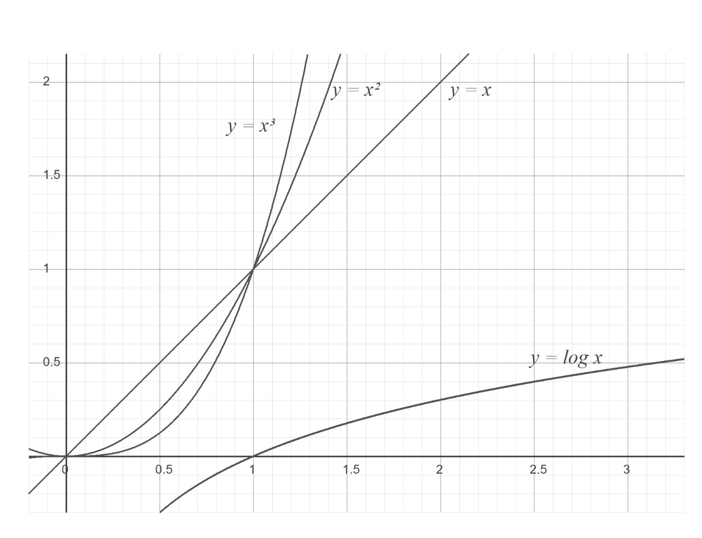

# PCCP 준비(1)

## 10주차 회고

SK Networks Family AI 부트 캠프에 36기로서 참여 중이다. 부트 캠프에서는 훈련생들에게 다양한 학습 지원을 제공하는데 그 중 하나가 프로그래머스의 PCCE/PCCP 테스트 비용 지원이다. 이와 더불어 부트 캠프 내의 다양한 서적을 대출할 수 있다. 도서들은 현재 부트 캠프 수업과 연계되는 내용을 다루고 있다. PCCE 합격 후 PCCP 준비를 고민하고 있었다. 프로그래머스에는 다양한 문제를 제공하지만, 단순 문제 풀이만으로 PCCP를 준비하기는 어려울 것 같았다. 체계적으로 개념부터 접근하고 싶었다. 이러한 계기로 부트 캠프 라운지에서 코딩 테스트와 관련된 책들을 찾아 살펴보았다.

그 중 구성이나 내용이 마음에 든 책은 박경록 님의 『코딩 테스트 합격자 되기』이다. 처음에는 대출해서 보았으나 아무래도 개념 설명을 더한 문제집이다보니 깨끗하게 읽고 반납하기 어렵다는 판단이 들어 교보문고에서 직접 구매했다. 배운 내용을 정리할 겸 공부한 내용을 블로그에 정리하기로 했다. 문제 등 교재 관련 내용 인용과 관련하여 LinkedIn을 통해 저자이신 박경록 님의 동의를 구했다. 출처 표기라는 전제 하에 흔쾌히 허락해주셨다. 감사한 마음을 전하고 싶다.

## 『코딩 테스트 합격자 되기』 03 알고리즘의 효율 분석

코딩 테스트 준비를 하기 위한 배경 지식으로 저자 분이 가장 강조하는 부분 중 하나가 시간 복잡도이다. 이는 프로그램의 성능을 결정하기 때문이다. 코딩 테스트에서 각 문제들은 ‘가장 효율적으로 해결하는 알고리즘’이 있다. 이 효율이 알고리즘이 문제를 푸는데 걸리는 시간을 결정한다. 이러한 효율을 시간 복잡도를 활요하여 추정할 수 있다.

시간 복잡도란 알고리즘의 성능을 나타내는 지표로서 입력 크기에 따라 걸리는 시간을 의미한다. 일반적으로 시간은 구현한 코드의 연산 횟수로 측정한다. 시간 복잡도는 낮을 수록 좋다. 이때 입력 크기란 알고리즘이 처리해야 할 데이터양이다.

알고리즘 수행 시간을 측정하는 방법은 크게 2가지이다. 절대 시간을 측정하는 방법과 시간 복잡도(연산 횟수)를 측정하는 방법이다. 절대 시간을 측정하는 방법은 프로그램 실행 환경에 따라 달라질 수 있어서 코딩 테스트에서는 잘 활용하지 않는다.

시간 복잡도를 측정하는 방법은 연산횟수와 관련이 있다. 시간 복잡도는 알고리즘이 시작한 순간부터 결과값이 나올 때까지의 연산횟수를 의미한다. 그 결과는 최선, 보통 최악으로 나누어진다. 시간 복잡도에서 입력 크기를 N으로 일반화하여 연산 횟수의 추이를 나타내야 한다. N을 굉장히 큰 수라고 가정하고 이 식을 좀 더 간결하게 표현하는 기법을 점근적 표기법이라고 한다. 코딩 테스트에서 시간 복잡도는 최악의 경우를 가정한다.

특정 알고리즘의 최악의 경우에서 시간 복잡도를 나타내는 방법은 빅오 표기법이다. 빅오 표기법은 점근적 표기법 중 하나로서 알고리즘의 상한을 나타낸다. 여기서 점근 표기법이란 어떤 함수의 증가하는 추세를 표현하는 표기법이다. 또한 상한선을 나타내는 빅오 표기법과 달리 빅오메가 표기법은 하한을 나타낸다.

### 빅오 표기법

| 수식 | 빅오 표기 |
| --- | --- |
| 3x2 + 5x + 6 | O(x2) -> 2차 다항함수 |
| X + logx | O(x) -> 1차 다항함수 |
| 2x + 10x5 +5x2 | O(2x) -> 지수함수 |
| 5x2 -6x | O(x2) -> 2차 다항함수 |

### 빅오 표기법의 원리

다음을 만족하는 g(x)가 있으면 f(x)의 최악의 시간 복잡도는 O(g(x))라 씀

특정 x 시점 이후부터 항상 f(x) ≤ C*g(x)

C는 상수

빅오 표기법은 f(x)의 최고차항만 남기고 계수를 지워 O(…)와 같이 쓸 수 있다. 로그함수는 다항함수보다 느리게 증가하고, 지수함수는 다항함수보다 빠르게 증가한다. 이를 그래프로 표기하면 다음과 같다.

다시 빅오를 정리하면 시간 복잡도의 점근적 상한으로서 빅오 상한의 정의를 만족하는 시간 복잡도 함수들의 집합으로 해석할 수 있다.

코딩 테스트 문제에는 제한 시간이 있다. 이때 문제를 분석한 후 빅오 표기법을 활용해서 해당 알고리즘을 적용했을 때 제한 시간 내에 출력값이 나올 수 있을지 확인해볼 수 있다. 보통 다음 기준으로 알고리즘을 선택한다.

> “컴퓨터가 초당 연산할 수 있는 최대 횟수는 1억 번이다.”

코딩 테스트에서 연산 횟수는 1,000~3,000만 정도로 고려해서 시간 복잡도를 생각하면 된다. 제한 시간 1초인 문제에서 각 시간 복잡도별로 허용할 수 있는 최대 연산 횟수는 다음과 같다.

| 시간 복잡도 | 최대 연산 횟수 |
| --- | --- |
| O(N!) | 10 |
| O(2N) | 20~25 |
| O(N3) | 200~300 |
| O(N2) | 3,000~5,000 |
| O(NlogN) | 100만 |
| O(N) | 1,000만~2,000만 |
| O(logN) | 10억 |

N(!)이 시간 복잡도가 가장 높은 것이 인상적이었다. 그래서 팩토리얼(계승)을 다시 살펴보기로 했다. 팩토리얼은 1부터 N까지의 모든 자연수를 곱한 값이다.

N!= Nx(N-1)x(N-2)x…x1

이와 같은 이유로 지수함수보다도 시간 복잡도가 높은 것이다.

### 별 찍기 문제

숫자 N을 입력받으면 N번째 줄까지 별을 1개부터 N깨까지 늘려가며 출력하기. 이때 연산 횟수 f(N)은 아래와 같다. 빅오 표기법으로는 O(N2)이다.

F(N)= 1+ 2+…+N = $\frac{N(N+1)}{2}$

### 박테리아 수명 문제

초기 박테리아 세포 개수가 N일 때 해마다 세포 개수가 이전 세포 개수의 반으로 준다면 언제 모든 박테리아가 죽을지 계산하기. 현재 박테리아의 수가 N이라면 1년 뒤의 박테리아의 수는 $\frac{1}{2}\times N$이다. Ｙ년후의 박테리아의 소멸 시기는 $(\frac{1}{2})^{y}\times  N$의 값이 최초로 1보다 작아질 때이다. 즉,

$(\frac{1}{2})^{y}\times  N<1$

인 Y를 찾으면 된다.

$Y \ge  log_{2}N$

이를 통해 알고리즘이 O(logN)의 시간 복잡도를 가짐을 알 수 있다.

현재 05 배열까지 학습을 마치고 스택을 공부할 차례이다. 하지만 굳이 03 알고리즘의 효율 분석을 돌아보는 이유는 저자 분이 강조한 부분이고 아직 충분히 숙지하지 못한 부분이기도 하기 때문이다. 현재 1회독 중이기 때문에 알고리즘이란 개념부터 모든 내용이 낯설기만 하다. 하지만 그럼에도 좀 더 비중을 두라고 조언한 데에는 그만한 이유가 있을 것이라는 생각에 배운 내용을 다시 복기해 보았다. 시간 복잡도는 낮을 수록 좋다. 코딩 테스트의 제한 시간 안에 프로그램이 끝날 수 있도록 시간 복잡도를 확인할 필요가 있으며 이때 점근적 표기법 중 빅오 표기법을 사용한다. 점근적 표기법은 입력 크기에 따른 연산 횟수의 추이를 활용해서 시간 복잡도를 표현하는 방법이다. 이 중 빅오 표기는 데이터 개수 N에 대해 연산 횟수를 일반화한 후, 최고 차항을 남기고 계수를 제거해 확인한다. 이것이 03 알고리즘의 효율 분석의 요점이다.
