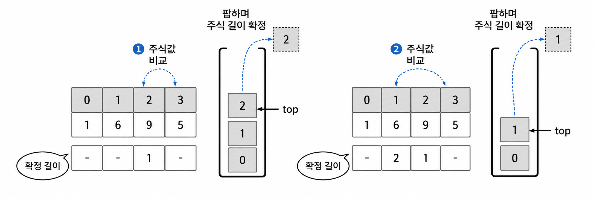

# [플레이데이터 SK네트웍스 Family AI 캠프 36기] PCCP 준비(2)

## 11주차 회고

박경록 님의 『코딩 테스트 합격자 되기』 파이썬 편을 공부하고 있다. 한주 내내 06 스택의 문제 12번에 멈춰있다. 코드 자체는 단순하다. 하지만 그 안에 담긴 알고리즘을 이해하는 것은 쉽지 않다. 해설 사이에 숨긴 행간의 의미를 이해하고 입력과 출력의 결과를 예측하는 과정은 낯설고 어려웠다. 결국 계속 반복하고 있다. 그것도 아주 느린 속도로. 단순히 써내는 것이 아니라 그 의미를 이해하면서 풀어야 하기 때문이다. 지금 같은 문제를 블로그를 정리하며 한번 더 반복하고자 한다.

## 문제 12 주식 가격

초 단위로 기록된 주식 가격이 담긴 배열 `prices`가 매개변수로 주어질 때, 가격이 떨어지지 않은 기간은 몇 초인지를 반환하도록 `solution()` 함수를 완성하세요.

### 제약 조건

- `prices`의 각 가격은 1 이상 10,000 이하인 자연수입니다.
- `prices`의 길이는 2 이상 100,000 이하입니다.

### 입출력의 예

| prices          | return          |
|-----------------|-----------------|
| `[1,2,3,2,3]`   | `[4,3,1,1,0]`   |

- 1초 시점의 ₩1은 끝까지 가격이 떨어지지 않습니다.
- 2초 시점의 ₩2은 끝까지 가격이 떨어지지 않습니다.
- 3초 시점의 ₩3은 1초 뒤에 가격이 떨어집니다. 따라서 1초간 가격이 떨어지지 않은 것으로 봅니다.
- 4초 시점의 ₩2은 1초간 가격이 떨어지지 않았습니다.
- 5초 시점의 ₩3은 0초간 가격이 떨어지지 않았습니다.

## 문제 이해하기

처음에는 '가격이 떨어지지 않는다'의 의미를 온전히 알지 못했다. 이 표현이 일종의 규칙일 것이라고 착각하기도 했다. 하지만 해당 표현은 리스트에 담긴 가격의 현상을 그대로 언급하고 있을 뿐 현재 리스트에 새로운 규칙을 부여하는 표현이 아니다.

또한, 문제에서 초 단위 기록을 언급했으므로 처음 가격은 1초 시점에서 시작한다. 1초 시점의 처음 가격 ₩1은 이후의 가격과 비교했을 때 항상 더 작다. 즉, ₩1을 기준 가격으로 했을 때 비교 가격(₩2, ₩3, ₩2, ₩3)이 기준가격보다 항상 더 크다. 이렇게 드러난 현상을 '끝까지 가격이 떨어지지 않는다'라고 언급한 것이다.

같은 방식으로 이후의 내용을 살펴볼 수 있다. 2초 시점의 ₩2는 이후의 비교 가격들(₩3, ₩2, ₩3)에 비해서 가격이 떨어지지 않는다. 3초 시점의 ₩3은 이후 비교 가격 ₩2에 비해 가격이 떨어진다. 이때 가격이 떨어지는데 걸리는 시간은 1초이다. 4초 시점의 ₩2는 비교 가격 ₩3에 비해 가격이 떨어지지 않는다. 이때 걸리는 시간은 1초이다. 5초 시점의 ₩3은 0초간 가격이 떨어지지 않는다.

알고리즘 문제에서 중요한 시간 복잡도에 대해 살펴보면, 권장 시간 복잡도는 O(N)이다. 책에서는 개념 이해를 위해 O(N<sup>2</sup>) 알고리즘과 O(N) 알고리즘 풀이를 모두 제시하고 있다. 몇 번 살펴본 문제라서 O(N) 알고리즘 풀이로 바로 넘어가려고 한다.

## O(N) 풀이 아이디어

연산 횟수를 줄이기 위한 방법 중 하나는 불필요한 연산을 줄이는 것이다. 책에서는 주식 가격이 처음으로 떨어지는 지점을 이용해 다른 지점의 길이를 효율적으로 계산한다.

1. 현재 주식보다 이전 주식의 가격이 높으면 이전 주식의 길이를 확정한다.
2. 이전 주식들을 하나씩 보고 현재 주식 가격보다 큰 주식 가격이 있다면 그 주식의 길이를 확정한다.
3. 길이를 확정한 주식은 이후 계산에서 제외한다.

연산 줄이기의 핵심은 길이를 확정한 주식은 이후 계산에서 제외하는 것이다. 최근 주식부터 이전 주식으로 거슬러 올라가며 비교하므로 스택을 사용한다. 그러면서 더 이상 고려하지 않을 주식은 팝한다. 결국 스택에 남는 원소는 길이를 확정하지 않은 주식, 즉, 가격이 끝까지 떨어지지 않은 주식이다. 책에 언급된 '길이를 확정한다'는 의미가 처음에 와닿지 않았다. 교재의 예를 보며 그 의미를 되새길 수 있었다.

예를 들어, `prices = [1, 6, 9, 5]`를 살펴보자. 가격 리스트의 인덱스는 0에서 3까지이다. 가격이 떨어지는 `prices[top]`과 `prices[3]`을 비교할 때 2가지를 알 수 있다. `prices[top]`은 이전 주식 가격이고, 지금은 이전 주식 가격이 현재 주식 가격보다 더 크므로 주식이 떨어진 상황이라는 것이다. 두 번째는 `prices[top]`을 팝하지 않으면서 순차적으로 현재 주식 가격까지 비교한 것은 이전까지는 주식 가격이 떨어지지 않았다는 것이다. 종합해서 top부터 현재 주식 가격 바로 직전 인덱스까지를 `prices[top]`의 길이로 특정할 수 있다. 따라서 현재 확인하는 인덱스 2는 길이를 1로 확정할 수 있다. 확정 후에는 인덱스 2를 팝하고 계속해서 그 앞을 비교한다. `prices[top] > prices[3]`이므로 인덱스 1의 길이를 2로 확정하고 팝한다.



## 1. 전체 코드와 문제의 목적

이제 코드를 살펴보자.

```python
def solution(prices):
    n = len(prices)
    answer = [0] * n

    # 스택을 사용해 이전 가격과 현재 가격 비교
    stack = [0]
    for i in range(1, n):
        while stack and prices[i] < prices[stack[-1]]:
            j = stack.pop()
            answer[j] = i - j
        stack.append(i)

    # 스택에 남아 있는 가격들은 가격이 떨어지지 않은 경우
    while stack:
        j = stack.pop()
        answer[j] = (n - 1) - j

    return answer
```

코드 자체는 길지 않다. 하지만 각 코드가 의미하는 바를 이해하는 것은 쉽지 않았다. 처음으로 돌아가 문제가 구하고자 하는 바는 '가격이 떨어지지 않은 기간은 몇 초인지를 반환하는 `solution()` 함수'이다.

코드를 정확하게 이해하기 위해서, 다음과 같은 주식가격이 주어졌다고 가정한다.

```python
prices = [1, 2, 3, 2, 3]
```

각 숫자는 1초 간격으로 기록된 주식가격이다.

| **인덱스(시간)** | **0** | **1** | **2** | **3** | **4** |
|------------------|-------|-------|-------|-------|-------|
| 가격             | 1     | 2     | 3     | 2     | 3     |
| 결과             | 4     | 3     | 1     | 1     | 0     |

최종 결과는 다음과 같다.

```python
answer = [4, 3, 1, 1, 0]
```

이것은 각 시점의 가격이 몇 초 동안 떨어지지 않았는지 나타내는 배열이다.

예를 들어 인덱스 2의 가격은 3이고, 다음 인덱스 3에서 가격이 2로 떨어진다. 따라서 1초가 기록된다.

중요한 것은 가격이 떨어진 시점까지의 시간도 포함한다는 점이다.

## 2. 변수와 배열 초기화

### ① `def solution(prices):`

- `def`는 함수를 정의하는 키워드다.
- `solution`은 함수 이름이다.
- `prices`는 함수가 전달받는 매개변수다.

여기서는 `prices = [1, 2, 3, 2, 3]`을 전달받았다고 가정한다.

### ② `n = len(prices)`

`len()`은 리스트의 원소 개수를 반환한다.

```python
prices = [1, 2, 3, 2, 3]
n = len(prices)
```

따라서 `n = 5`가 된다.

여기서 `n`은 리스트의 길이다.

- 리스트 길이: 5
- 마지막 인덱스: 4
- 마지막 인덱스를 표현하는 식: `n - 1`

이 구분이 마지막 while문에서 중요하다.

### ③ `answer = [0] * n`

원소가 모두 0인 리스트를 만드는 코드이다.

```python
[0] * 5
```

결과는 다음과 같다.

```python
answer = [0, 0, 0, 0, 0]
```

이 배열은 각 가격이 떨어지지 않은 시간을 저장할 공간이다.

아직 계산하지 않았으므로 모든 값을 0으로 초기화한다.

### ④ `stack = [0]`

`stack = [0]`은 스택에 숫자 0을 넣고 시작한다는 의미이다.

여기서 0은 주식가격이 아니다.

주식가격의 인덱스 0을 저장한 것이다.

**prices 배열**

| 0   | 1   | 2   | 3   | 4   |
|-----|-----|-----|-----|-----|
| 1   | 2   | 3   | 2   | 3   |

**초기 stack**

```python
stack = [0]
```

스택의 0은 가격 1이 저장된 위치를 가리킨다.

처음부터 0을 넣는 이유는 다음 반복문이 `range(1, n)`으로 시작하기 때문이다. 인덱스 0은 미리 스택에 넣고, 인덱스 1부터 차례로 비교하는 구조이다.

## 3. for 문

### ⑤ `for i in range(1, n):`

현재 `n = 5`이므로 다음과 같다.

```python
for i in range(1, 5):
```

`range(1, 5)`는 1부터 4까지의 정수를 만든다.

따라서 `i`는 순서대로 1, 2, 3, 4가 된다.

여기서 `i`는 현재 확인하고 있는 주식가격의 인덱스다.

그리고 스택에는 아직 가격이 떨어진 시점이 확인되지 않은 과거의 인덱스들이 들어 있다.

### ⑥ `while stack and prices[i] < prices[stack[-1]]:`

이 코드가 문제의 핵심이다.

우선 조건을 두 부분으로 나눈다.

**첫 번째 조건: `stack`**

파이썬에서는 리스트가 비어 있지 않으면 `True`, 비어 있으면 `False`로 판단한다.

따라서 `while stack`은 스택에 원소가 있는 동안이라는 의미이다.

**두 번째 조건: `prices[i] < prices[stack[-1]]`**

여기서 `stack[-1]`은 스택의 마지막 원소, 즉 가장 위에 있는 인덱스를 의미한다.

예를 들어,

```python
stack = [0, 1, 2]
i = 3
```

이라면 다음과 같이 해석한다.

```python
stack[-1] = 2
prices[i] = prices[3] = 2
prices[stack[-1]] = prices[2] = 3
```

결국 비교하는 식은 다음과 같다.

```python
2 < 3  # True
```

현재 가격이 이전 가격보다 떨어졌다는 뜻이다.

`and`는 두 조건이 모두 참이어야 하므로, 스택이 비어 있지 않고 현재 가격이 스택 맨 위 인덱스의 가격보다 낮을 때만 while문 내부를 실행한다.

스택이 비어 있으면 오른쪽의 `prices[stack[-1]]`은 평가하지 않기 때문에 인덱스 오류도 방지할 수 있다.

### ⑦ `j = stack.pop()`

`pop()`은 리스트의 마지막 원소를 꺼내면서 제거하는 메서드다.

```python
stack = [0, 1, 2]
j = stack.pop()
```

결과는 다음과 같다.

```python
j = 2
stack = [0, 1]
```

왜 인덱스 2를 제거할까?

현재 가격이 2이고, 인덱스 2의 가격은 3이다. 이미 가격이 떨어졌으므로 더 이상 인덱스 2의 기간을 추적할 필요가 없다.

따라서 스택에서 제거한다.

### ⑧ `answer[j] = i - j`

이 코드는 가격이 떨어지지 않은 기간을 계산한다.

현재 상황에서

- `i = 3`: 가격이 떨어진 현재 시점
- `j = 2`: 이전 가격이 기록된 시점

이므로

```python
answer[2] = 3 - 2
answer[2] = 1
```

결과는 다음과 같다.

```python
answer = [0, 0, 1, 0, 0]
```

즉 인덱스 2의 주식가격 3은 1초 뒤에 떨어졌다는 의미이다.

여기서 기억해야 할 점은 `i`와 `j` 모두 가격이 아니라 인덱스라는 점이다.

### ⑨ `stack.append(i)`

`append()`는 리스트의 마지막에 원소를 추가하는 메서드이다.

```python
stack.append(i)
```

현재 인덱스 `i`를 스택에 추가한다.

현재 시점의 가격도 앞으로 언제 떨어질지 확인해야 하기 때문이다.

주의할 점은 `append(i)`가 while문 밖에 있고 for문 안에 있다는 점이다.

따라서 while 조건이 거짓이어서 내부가 실행되지 않아도 `append(i)`는 실행된다.

## 4. 전체 반복문 실행

이제 다섯 개의 주식가격을 하나씩 처리해 본다. 가격이 같거나 더 높아지다 인덱스 2에서 3으로 바뀌면서 가격이 떨어진다.

```text
pop(2) → answer[2] = 3 - 2 = 1
```

`2 < 3`은 `True`. 인덱스 2를 꺼내 `answer[2] = 1`로 확정한다. 다음 `2 < 2`는 `False`이므로 인덱스 3을 추가한다.

여기서 중요한 사실을 하나 발견할 수 있다.

`i = 3`일 때 가격이 떨어진 인덱스 2는 스택에서 제거되지만, 인덱스 0과 1은 그대로 남아 있다는 점이다.

그 이유는 현재 가격 2가 인덱스 1의 가격 2보다 작지 않기 때문이다. 또한 가격이 같으면 떨어진 것으로 판단하지 않는다.

## 5. 마지막 while문

현재 상태는 다음과 같다.

```python
stack = [0, 1, 3, 4]
answer = [0, 0, 1, 0, 0]
n = 5
```

그런데 아직 스택에 네 개의 인덱스가 남아 있다.

이 인덱스들은 이후에 자신보다 낮은 가격을 만나지 못한 시점들이다.

그래서 마지막 while문으로 처리한다.

### ⑩ `while stack:`

```python
while stack:
```

스택에 원소가 남아 있는 동안 계속 실행하라는 뜻이다.

첫 번째 while문과 다음과 같은 차이가 있다.

- 첫 번째 while: 현재 가격이 이전 가격보다 떨어졌을 때 실행
- 두 번째 while: 모든 가격을 확인한 후 스택에 남은 인덱스를 처리

두 번째 while문에서는 더 이상 가격을 비교하지 않는다.

### ⑪ `j = stack.pop()`

스택 맨 위의 인덱스를 꺼낸다.

현재 스택은 `[0, 1, 3, 4]`이므로 처음 꺼내는 값은 4이다.

```python
j = 4
stack = [0, 1, 3]
```

### ⑫ `answer[j] = (n - 1) - j`

이 부분은 앞에서 사용한 `answer[j] = i - j`와 매우 비슷하다.

하지만 여기서는 가격이 떨어진 시점 `i`가 존재하지 않는다.

따라서 마지막 시점인 `n - 1`을 기준으로 기간을 계산한다.

현재 `n = 5`이므로 `n - 1 = 4`이다.

| **꺼낸 j** | **계산** | **결과** |
|------------|----------|----------|
| 4          | 4 - 4    | 0        |
| 3          | 4 - 3    | 1        |
| 1          | 4 - 1    | 3        |
| 0          | 4 - 0    | 4        |

이 계산을 마치면 스택은 빈다.

```python
stack = []
answer = [4, 3, 1, 1, 0]
```

여기서 인덱스 1의 결과가 3인 이유도 확인해 보자.

인덱스 1의 가격은 2이다. 이후 가격은 3, 2, 3으로 움직인다. 가격이 같아진 적은 있지만 2보다 낮아진 적은 없다.

따라서 마지막 시점까지 3초 동안 가격이 떨어지지 않은 것이다.

### ⑬ `return answer`

마지막으로 계산한 배열을 반환한다.

```python
return answer
```

결과는 다음과 같다.

```python
[4, 3, 1, 1, 0]
```

## 6. 두 개의 while문 비교

| **구분**  | **첫 번째 while** | **두 번째 while**              |
|-----------|-------------------|--------------------------------|
| 위치      | for문 내부        | for문 외부                     |
| 실행 조건 | 가격이 떨어짐     | 스택에 원소가 남음             |
| 가격 비교 | 있음              | 없음                           |
| `pop()`   | 있음              | 있음                           |
| 기간 계산 | `i - j`           | `(n - 1) - j`                  |
| 목적      | 하락한 시점 확정  | 끝까지 하락하지 않은 기간 확정 |

이 문제의 핵심은 두 while문이 서로 다른 상황을 처리한다는 점이다.

첫 번째는 가격이 떨어진 순간에 기간을 확정하고, 두 번째는 끝까지 떨어지지 않은 가격의 기간을 확정한다.

## 7. 스택을 사용하는 이유

스택을 사용하지 않는다면 각 시점마다 이후 가격을 하나씩 비교할 수도 있다.

하지만 그러면 최악의 경우 O(n<sup>2</sup>)의 시간 복잡도가 발생한다.

반면 이 코드에서는 각 인덱스가 스택에 한 번 들어가고, 한 번만 나온다.

따라서 전체 시간 복잡도는 O(n)이다.

## 8. 반드시 숙지할 다섯 가지

1. `stack`에는 주식가격이 아니라 인덱스를 저장한다.
2. `stack[-1]`은 스택 맨 위의 인덱스이며, `prices[stack[-1]]`은 그 인덱스의 가격이다.
3. `pop()`은 인덱스를 꺼내면서 스택에서 제거한다.
4. `answer[j] = i - j`는 가격이 떨어진 시점까지의 시간을 계산한다.
5. `answer[j] = (n - 1) - j`는 마지막 시점까지 가격이 떨어지지 않은 시간을 계산한다.

내 경우, 4번과 5번이 가장 이해하기 어려운 부분이었다. 이 코드에서 `i`는 현재 시점이고, `j`는 결과를 확정할 과거 시점이다.
