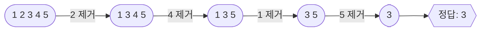
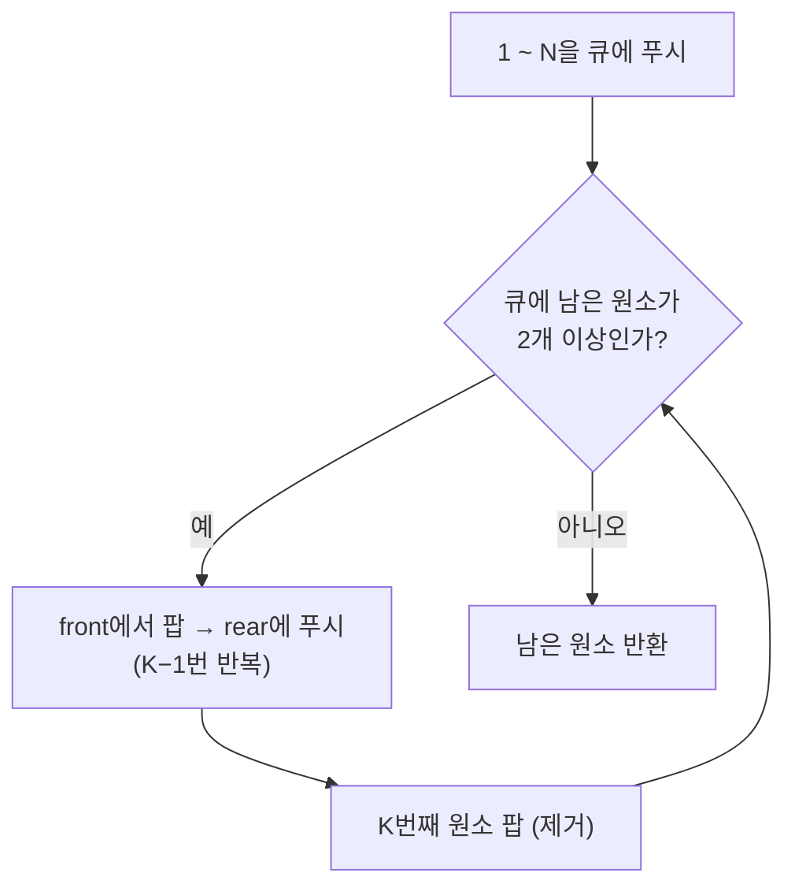
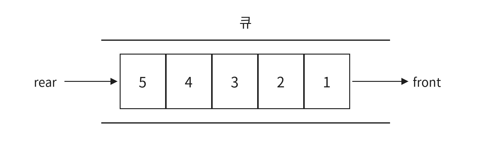
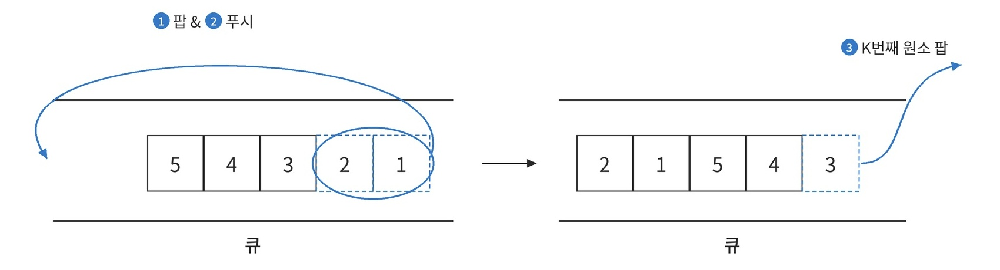
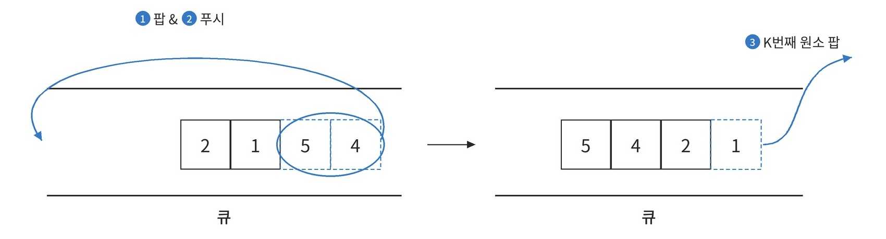
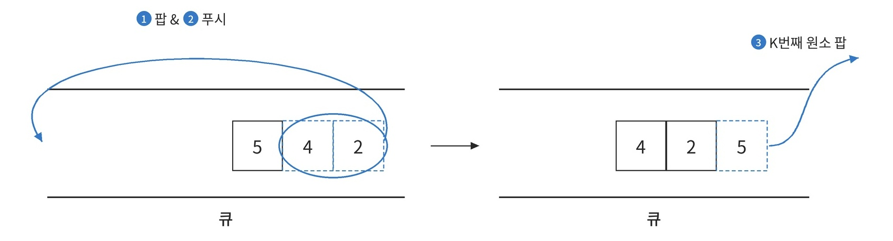
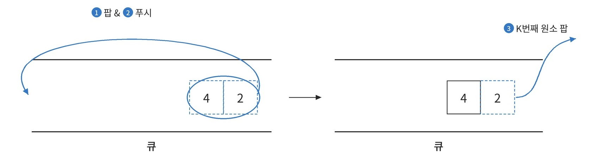
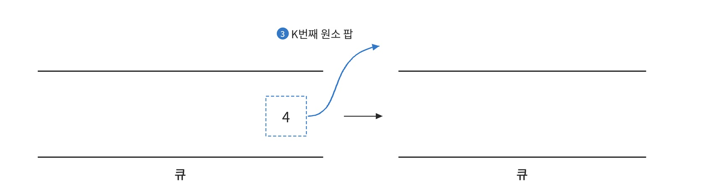

# PCCP 준비 (6) — 15주차 회고

> **문제 15. 요세푸스 문제**
> 출처: 『코딩 테스트 합격자 되기 — 파이썬 편』, 박경록, 골든래빗, 2024

## 목차

1. [문제](#-문제)
2. [손으로 풀어보기 (N=5, K=2)](#-손으로-풀어보기-n5-k2)
3. [문제 분석하고 풀기](#-문제-분석하고-풀기)
4. [큐로 따라가기 (N=5, K=3)](#-큐로-따라가기-n5-k3)
5. [전체 코드](#-전체-코드)
6. [코드 해석](#-코드-해석)
7. [실행 예시 (N=5, K=2)](#-실행-예시-n5-k2)
8. [정리](#-정리)
9. [더 알아보기: `deque.rotate()`](#-더-알아보기-dequerotate)

---

## 📝 문제

N명의 사람이 원 형태로 서 있다. 각 사람은 1부터 N까지 번호표를 갖고 있다. 임의의 숫자 K가 주어졌을 때 다음과 같이 사람을 없앤다.

- 1번 번호표를 가진 사람을 기준으로 K번째 사람을 없앤다.
- 없앤 사람 다음 사람을 기준으로 하고 다시 K번째 사람을 없앤다.

N과 K가 주어질 때 마지막에 살아 있는 사람의 번호를 반환하는 `solution()` 함수를 구현하라.

> [!NOTE]
> 이 문제는 유대인 역사가 플라비우스 요세푸스가 만든 문제다.

### 제약 조건

- N과 K는 1 이상 1,000 이하의 자연수다.

### 입출력의 예

| N | K | return |
|:-:|:-:|:------:|
| 5 | 2 | 3 |

---

## ✋ 손으로 풀어보기 (N=5, K=2)

N=5이므로 번호표를 1~5로 붙이고 사람을 원형으로 배치한다. 기준은 1이다.

| 단계 | 진행 |
|:---:|---|
| 01단계 | 기준이 1이므로 K번째 사람은 **2번**이다. 2번을 제거하고 다음 위치를 3으로 한다. |
| 02단계 | 같은 방식으로 **4번**을 제거하고 다음 위치를 5로 한다. 이어서 **1번**을 제거하고 다음 위치를 3으로 한다. |
| 03단계 | 3 다음은 다시 5이고, **5번**을 제거하면 **3번**만 남는다. |



---

## 🔍 문제 분석하고 풀기

사람들이 원형 테이블에 앉아 있다고 생각하고, 1번부터 일정한 방향으로 한 사람씩 지목한다. 사람이 사라진 후에도 지목 방향은 바꾸지 않는다. 그리고 맨 마지막 사람을 지목한 다음에는 다시 처음으로 돌아간다.

> [!TIP]
> 그림을 보면 "원형 큐로 풀어야 하나?" 싶을 수 있다. 하지만 코딩 테스트에서는 파이썬의 리스트나 덱을 써도 메모리를 크게 낭비하지 않으므로 원형 큐를 쓰지 않아도 된다.

선형 큐를 이용해 푸는 과정은 다음과 같다.

1. 첫 번째 데이터부터 마지막 데이터까지 큐에 푸시한다.
2. 큐에서 K−1번째까지의 데이터를 각각 front에서 팝하고 rear에 푸시한다.
3. K번째 데이터를 팝한다.
4. 과정 2~3을 큐에 원소가 하나 남을 때까지 반복한다.



과정 2와 3이 K번째 사람을 제외하는 과정이다. K−1번째 사람까지 팝하고 푸시하면 그 사람들이 큐의 가장 뒤로 가고, K번째 사람이 맨 앞에 온다. 이후 K번째 사람을 팝하는 과정을 반복하면 매번 K번째 사람을 제외할 수 있다.

---

## 🧩 큐로 따라가기 (N=5, K=3)

다른 예로 다시 살펴보자. N은 5이고 K는 3이다. 그림에서 **오른쪽이 front**(꺼내는 쪽), **왼쪽이 rear**(넣는 쪽)다.

<p align="center"></p>

### 01단계

K−1번째 원소까지 팝하고 푸시하면 1, 2를 각각 팝하고 푸시하므로 큐는 2, 1, 5, 4, 3이 되고 2가 맨 뒤에 위치한다. 이 과정을 통해 자연스럽게 팝할 데이터는 3이 된다. 제거해야 할 K번째 원소가 맨 앞으로 오는 것이다.

<p align="center"></p>

### 02단계

다시 4, 5를 각각 팝하고 푸시한다. 마지막 데이터는 5가 되며, 팝할 데이터는 1이 된다.

<p align="center"></p>

### 03단계 ~ 05단계

같은 방법으로 계속해서 팝, 푸시를 진행한다.

<p align="center"></p>
<p align="center"></p>
<p align="center"></p>

> [!NOTE]
> 05단계 그림은 마지막 남은 4를 꺼내는 모습이지만, 실제 코드는 `while len(queue) > 1` 조건 때문에 한 명이 남으면 반복을 끝내고 `queue[0]`(= 4)을 반환한다.

---

## 💻 전체 코드

```python
from collections import deque

def solution(N, K):
    queue = deque(range(1, N + 1))

    while len(queue) > 1:
        for _ in range(K - 1):
            queue.append(queue.popleft())

        queue.popleft()
    return queue[0]
```

---

## 📖 코드 해석

#### `from collections import deque`
- `collections` 모듈에서 `deque`(덱)를 가져온다.
- 덱은 앞과 뒤 양쪽에서 넣고 빼는 작업이 모두 O(1)이다. 리스트의 `pop(0)`은 O(n)이므로 이 문제에는 덱이 더 알맞다.

#### `def solution(N, K):`
- 사람 수 `N`과 제거 간격 `K`를 받는 함수를 정의한다.

#### `queue = deque(range(1, N + 1))`
- 1부터 N까지의 번호로 덱을 만든다. 예: N=5이면 `deque([1, 2, 3, 4, 5])`.
- 원형으로 앉은 사람들을 한 줄로 늘어놓은 것으로 보면 된다. 맨 앞이 지금 차례인 사람이다.

#### `while len(queue) > 1:`
- 한 명이 남을 때까지 반복한다.

#### `for _ in range(K - 1):`
- K번째 사람 앞까지, 즉 K−1명을 건너뛰는 반복이다.
- `_`는 반복 횟수만 필요하고 값은 쓰지 않는다는 관례적 표기다.

#### `queue.append(queue.popleft())`
- 맨 앞 사람을 빼서(`popleft`) 맨 뒤에 다시 넣는다(`append`). 원을 한 칸 돌리는 효과다.
- K−1번 반복하면 K번째 사람이 맨 앞에 오게 된다.

#### `queue.popleft()`
- 맨 앞에 온 K번째 사람을 제거한다. 다시 넣지 않으므로 원에서 빠진다.

#### `return queue[0]`
- 반복이 끝나면 덱에는 한 명만 남는다. 그 사람의 번호를 반환한다.

---

## ▶️ 실행 예시 (N=5, K=2)

| 단계 | 회전 후 덱 (맨 앞이 제거 대상) | 제거되는 사람 |
|:---:|:---:|:---:|
| 시작 | `[1, 2, 3, 4, 5]` | — |
| 1회차 | `[2, 3, 4, 5, 1]` | 2 |
| 2회차 | `[4, 5, 1, 3]` | 4 |
| 3회차 | `[1, 3, 5]` | 1 |
| 4회차 | `[5, 3]` | 5 |
| 결과 | `[3]` | **3 반환** |

---

## ✅ 정리

- **시간 복잡도: O(N × K)**
  한 바퀴마다 팝 K번, 푸시 K−1번으로 총 2K−1번 연산하고, 이를 N−1번 반복한다. 빅오에서는 상수와 덜 빨리 자라는 항을 버리므로 (N−1)(2K−1) → **O(N × K)** 가 된다.
- 다른 결과 예: `solution(7, 3)` → `4`, `solution(1, 1)` → `1`
- 변수 이름을 한 가지(`queue`)로 통일해야 한다. **`que`와 `queue`를 섞어 쓰면 `NameError`가 난다.**
- `deque()`와 `deque( )`처럼 괄호 안의 공백은 동작에 영향이 없다. 다만 PEP 8은 공백 없이 쓰는 것을 권장한다.

---

## 💡 더 알아보기: `deque.rotate()`

`rotate()`는 덱의 원소를 한꺼번에 빙 돌리는 메서드다.

| 호출 | 방향 | 결과 (`[1, 2, 3, 4, 5]`에서) |
|---|---|---|
| `rotate(2)` | 양수 → 오른쪽. 맨 뒤 원소가 맨 앞으로 온다. | `[4, 5, 1, 2, 3]` |
| `rotate(-2)` | 음수 → 왼쪽. 맨 앞 원소가 맨 뒤로 간다. | `[3, 4, 5, 1, 2]` |

안쪽 `for`문은 맨 앞을 빼서 맨 뒤로 넣는 일을 K−1번 하므로, **왼쪽으로 K−1칸 회전**과 같다. 왼쪽은 음수이므로 `-(K - 1)`을 넘긴다.

- `K - 1`: 몇 칸 돌릴지
- `-` 부호: 어느 방향으로 돌릴지 (왼쪽)

괄호를 빼고 `-K - 1`로 쓰면 −K−1이 되어 틀린 값이 되므로 괄호가 꼭 필요하다.

```python
from collections import deque

def solution(N, K):
    queue = deque(range(1, N + 1))

    while len(queue) > 1:
        queue.rotate(-(K - 1))   # K번째 사람을 맨 앞으로
        queue.popleft()          # 제거

    return queue[0]
```

> [!NOTE]
> `rotate`도 내부적으로 원소를 하나씩 옮기므로 시간 복잡도는 그대로 O(N × K)다. 다만 C로 구현되어 있어 파이썬 `for`문보다 조금 빠르고 코드가 짧아진다.
