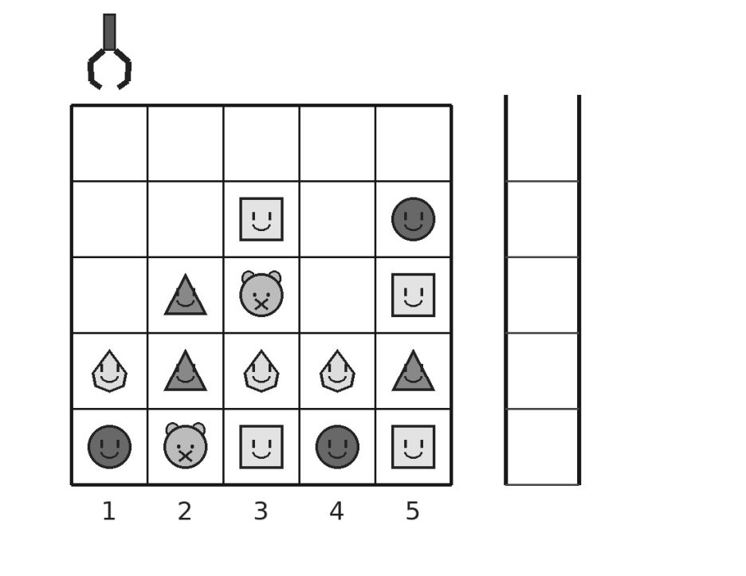
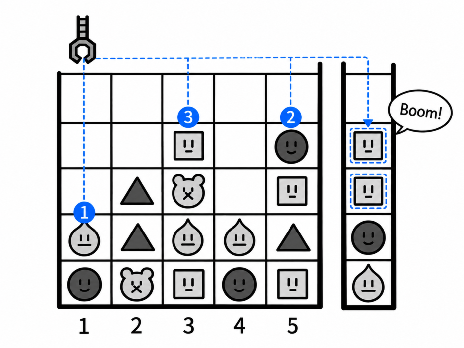
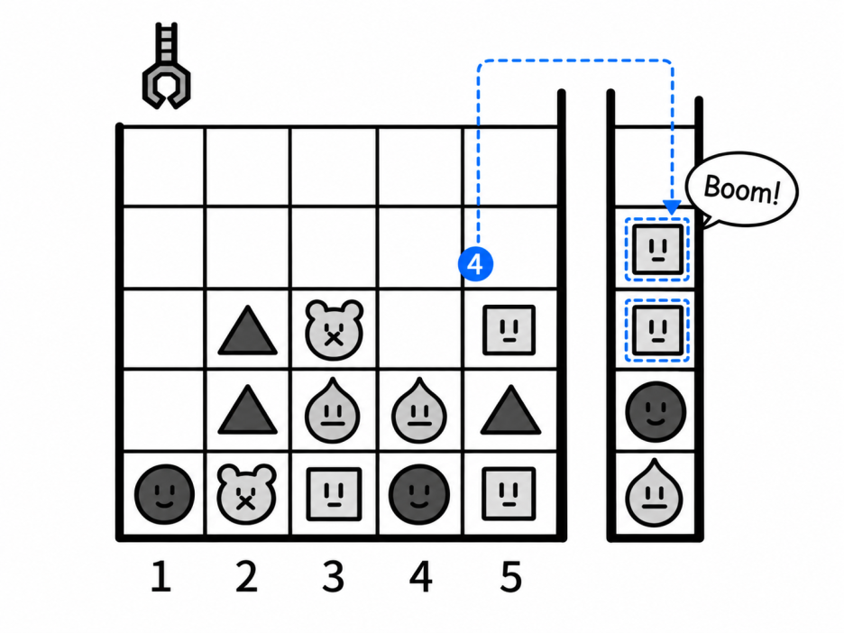
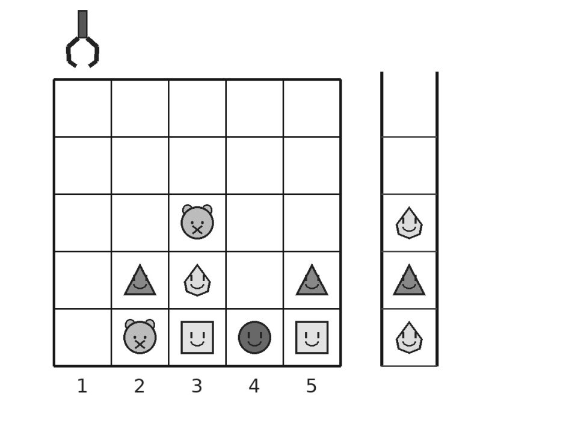

# \[플레이데이터 SK네트웍스 Family AI 캠프 36기\] PCCP 준비(3)

## 12주차 회고

이번주 내내 박경록 님의 『코딩 테스트 합격자 되기』 파이썬 편 문제 13을 풀고 있다. 문제를 읽고 내용을 이해하고 코드를 분석하고 직접 다시 적용해보는 과정을 반복했다. 부트 캠프를 마치고 혼자 공부하는 중이다. 내 경우 스터디도 이러한 공부를 어느 정도 혼자 해낸 후에 하는 것이 맞다고 생각한다. 문제 13을 처음 마주했을 때 문제 12보다 쉽다고 생각했다. 크레인 인형 뽑기 게임은 문제 내용이 직관적으로 이해하기 쉽기 때문이다. 하지만 두어번 다시 풀어보니 코드 내용이 역순 탐색, 행열 스택을 열별 스택으로 변환하는 과정 등을 담고 있어서 이해하기 쉽지 않았다. 즉, 크레인 인형 뽑기 게임의 내용은 이미 내가 경험해본 익숙한 내용을 다루지만 그 내용을 코드로 구현하는 것은 전혀 다른 차원의 문제였던 것이다. 

## 문제13 크레인 인형 뽑기 게임

게임 개발자인 죠르디는 크레인 인형 뽑기 기계를 모바일 게임으로 만들려고 합니다. 죠르디는 게임의 재미를 높이기 위해 화면 구성과 규칙을 다음과 같이 게임 로직에 반영하려고 합니다.



게임 화면은 1 x 1 크기의 격자로 구성된 N x N 크기의 격자이며 위쪽에는 크레인이 있고 오른쪽에는 바구니가 있습니다. 여러분이 보고 있는 화면은 5 x 5 크기의 격자 예입니다. 각 격자 칸에는 다양한 인형이 들어 있으며 인형이 없는 칸은 빈 칸입니다. 인형은 격자 한 칸을 차지하며 격자의 가장 아래 칸부터 차곡차곡 쌓입니다. 플레이어는 크레인을 좌우로 움직일 수 있고 크레인을 멈춘 위치에서 가장 위에 있는 인형을 집어 올릴 수 있습니다. 집어 올린 인형은 바구니에 쌓입니다. 이때 바구니의 가장 아래 칸부터 인형이 순대로 쌓입니다. 다음은 ①②③ \[1번, 5번, 3번\] 위치에서 순서대로 인형을 집어올려 바구니에 담은 모습입니다. 



이 상태에서 ④ 네모 인형이 1개 더 들어가면 어떻게 될까요? 같은 모양의 인형 2개가 바구니에 연속해 쌓이면 두 인형은 펑하고 터지며 사라집니다. 만약 인형이 없는 곳에서 크레인을 작동시키면 아무 일도 일어나지 않습니다. 또 바구니는 모든 인형이 들어갈 수 있을 만큼 충분히 큽니다. 2차원 배열 board와 인형을 집는 크레인을 작동시킨 위치가 담긴 배열 moves가 주어질 때, 크레인을 모두 작동시킨 후 사라진 인형 개수를 반환하는 solution() 함수를 완성하세요.



### 제약 조건

board는 2차원 배열, 크기는 5 x 5 이상 30 x 30 이하입니다.

board의 각 칸에는 0 이상 100 이하인 정수가 담겨 있습니다.

- 0은 빈 칸을 나타냅니다.

- 1 ~ 100의 각 숫자는 각기 다른 인형의 모양을 의미하며 같은 숫자는 같은 모양의 인형을 나타냅니다.

moves 배열 크기는 1 이상 1,000 이하입니다.

moves 배열 각 원소들의 값은 1 이상이며 board 배열의 가로 크기 이하인 자연수입니다.

### 입출력의 예

| board | moves | result |
| --- | --- | --- |
| \[\[0,0,0,0,0\], \[0, 0, 1, 0, 3\], \[0, 2, 5, 0, 1\], \[4, 2, 4, 4, 2\], \[3, 5, 1, 3, 1\]\] | \[1, 5, 3, 5, 1, 2, 1, 4\] | 4 |

위와 같이 입출력이 주어지면 크레인이 \[1, 5, 3, 5, 1, 2, 1, 4\]번 위치에서 차례대로 인형을 집어서 바구니에 옮겨 담고, 최종으로 다음과 같은 상태가 됩니다. 



문제출처: 박경록 『코딩 테스트 합격자 되기』 파이썬 편, GOLDEN RABBIT, 2024 

2019 카카오 개발자 겨울 인턴십

## 1. 문제의 규칙과 핵심 착상

N×N 격자 board에서 크레인은 moves에 적힌 열 번호를 차례대로 선택한다. 선택한 열의 가장 위에 있는 인형 하나를 꺼내 바구니에 쌓는다. 바구니의 맨 위 두 인형이 같아지면 두 인형이 사라진다. 최종적으로 사라진 인형 수를 반환한다.

핵심 착상: board는 행 중심으로 저장되어 있지만 크레인은 열을 선택한다. 따라서 각 열을 독립적인 스택으로 만들어 두면, 맨 위 인형을 pop() 한 번으로 꺼낼 수 있다. 이 변환은 유일한 풀이가 아니라 효율적인 설계 선택이다.

## 2. 전체 코드

```python
def solution(board, moves):
    lanes = [[] for _ in range(len(board[0]))]
 
    for i in range(len(board) - 1, -1, -1):
        for j in range(len(board[0])):
            if board[i][j]:
                lanes[j].append(board[i][j])
 
    bucket = []
    answer = 0
 
    for m in moves:
        if lanes[m - 1]:
            doll = lanes[m - 1].pop()
 
            if bucket and bucket[-1] == doll:
                bucket.pop()
                answer += 2
            else:
                bucket.append(doll)
 
    return answer
```

## 3. ① 열 개수만큼 빈 스택 생성

```python
lanes = [[] for _ in range(len(board[0]))]
```

board\[0\]은 첫 번째 행 전체다. len(board\[0\])은 그 행의 원소 수, 즉 열 개수다. 5×5 board라면 lanes = \[\[\], \[\], \[\], \[\], \[\]\]가 된다. 각 내부 리스트는 한 열의 인형을 담는 독립적인 스택이다.

주의: board\[2\]는 세 번째 행이지만 lanes\[2\]는 세 번째 열을 나타낸다. 리스트 표기 모양이 아니라 개발자가 어떤 데이터를 모았는지가 의미를 결정한다.

## 4. ② 아래에서 위로 읽고, 열별 스택에 저장

```python
for i in range(len(board) - 1, -1, -1):
    for j in range(len(board[0])):
        if board[i][j]:
            lanes[j].append(board[i][j])
```

### 4-1. range()의 세 인수

range(시작값, 종료값, 간격)에서 종료값은 포함되지 않는다. 길이가 5이면 range(4, -1, -1)은 4, 3, 2, 1, 0을 생성한다. 마지막 인덱스 0까지 포함하려고 종료 경계를 -1로 둔다. -1이 세 번 나오는 것이 아니라, len(board)-1(시작), -1(종료), -1(간격)의 세 자리다.

### 4-2. i는 행, j는 열

바깥 반복문 i는 4→3→2→1→0으로 이동하고, 각 행에서 안쪽 반복문 j는 0→1→2→3→4로 이동한다. board\[i\]\[j\]는 해당 칸의 인형 번호다. lanes\[j\]는 j번째 열에 대응하는 저장 공간이다.

### 4-3. 불리언을 이용한 빈칸 처리

```python
if board[i][j]:
    lanes[j].append(board[i][j])
```

문제에서 0은 빈칸이다. Python에서 bool(0)은 False이고 0이 아닌 정수는 True이므로, if board\[i\]\[j\]는 이 문제에서 if board\[i\]\[j\] != 0과 같다. i=0, j=0 자체가 빈칸이라는 뜻이 아니라 board\[0\]\[0\]에 들어 있는 값을 검사한다.

### 4-4. 실제 순회 9회 예제

```python
board = [
    [0, 0, 1],
    [2, 0, 3],
    [4, 5, 6]
]
lanes = [[], [], []]
```

| 순서 | i | j | 값 | 해당 열의 변화 |
| --- | --- | --- | --- | --- |
| 1 | 2 | 0 | 4 | lanes\[0\] = \[4\] |
| 2 | 2 | 1 | 5 | lanes\[1\] = \[5\] |
| 3 | 2 | 2 | 6 | lanes\[2\] = \[6\] |
| 4 | 1 | 0 | 2 | lanes\[0\] = \[4, 2\] |
| 5 | 1 | 1 | 0 | 0이므로 건너뜀 |
| 6 | 1 | 2 | 3 | lanes\[2\] = \[6, 3\] |
| 7 | 0 | 0 | 0 | 건너뜀 |
| 8 | 0 | 1 | 0 | 건너뜀 |
| 9 | 0 | 2 | 1 | lanes\[2\] = \[6, 3, 1\] |

```python
lanes = [[4, 2], [5], [6, 3, 1]]
```

읽는 순서는 행별이지만, 저장되는 곳은 열별이다. 또한 각 열을 아래→위 순서로 저장하므로 리스트의 마지막 값이 실제 가장 위의 인형이다. 이것이 pop()으로 꺼낼 수 있는 이유다.

## 5. ③ 바구니와 ④ 정답 변수 초기화

```python
bucket = []
answer = 0
```

bucket은 뽑힌 인형을 순서대로 쌓는 스택이다. answer는 바구니에서 사라진 인형의 누적 개수다. 두 인형이 한 번에 사라질 때마다 2를 더한다.

## 6. ⑤ moves 순회: 지정된 열에서 인형 뽑기

```python
for m in moves:
    if lanes[m - 1]:
        doll = lanes[m - 1].pop()
```

moves의 열 번호는 1부터 시작하지만 Python 리스트 인덱스는 0부터 시작한다. 따라서 m=3이면 lanes\[2\], 즉 세 번째 열을 선택한다. if lanes\[m-1\]은 그 열의 리스트가 비어 있지 않은지 검사한다. 빈 리스트 \[\]는 False이므로 인형이 없으면 pop()도, 바구니 처리도 실행하지 않는다.

예: lanes\[2\] = \[1, 4, 5, 1\]일 때 pop() 결과 doll=1이고 lanes\[2\]는 \[1, 4, 5\]로 바뀐다. pop()은 인덱스를 꺼내는 것이 아니라 마지막 원소의 값을 반환하면서 리스트에서 제거한다.

## 7. ⑥ 바구니 맨 위와 같으면 두 인형 제거

```python
if bucket and bucket[-1] == doll:
    bucket.pop()
    answer += 2
```

and의 왼쪽 bucket은 바구니가 비어 있지 않음을 확인한다. 비어 있다면 오른쪽 bucket\[-1\]은 평가되지 않아 IndexError를 피한다(단락 평가). bucket\[-1\]은 바구니 맨 위의 인형 값이다. 새로 뽑은 doll과 같으면 기존 맨 위 인형을 pop()으로 제거하고, 새 인형 doll도 바구니에 넣지 않으므로 두 개가 함께 사라진다.

## 8. ⑦ 다르면 바구니에 추가

```python
else:
    bucket.append(doll)
```

바구니가 비어 있거나 맨 위 인형과 새 인형이 다르면 doll을 바구니 끝에 추가한다. 새로 들어온 인형이 다음 비교의 대상이 된다.

## 9. 실제 문제 예제: moves에 따른 변화

```python
board = [
    [0, 0, 0, 0, 0],
    [0, 0, 1, 0, 3],
    [0, 2, 5, 0, 1],
    [4, 2, 4, 4, 2],
    [3, 5, 1, 3, 1]
]
moves = [1, 5, 3, 5, 1, 2, 1, 4]
```

초기 열별 스택: \[\[3,4\], \[5,2,2\], \[1,4,5,1\], \[3,4\], \[1,2,1,3\]\]

| 차례 | m | doll | 바구니 처리 후 | 누적 제거 |
| --- | --- | --- | --- | --- |
| 1 | 1 | 4 | \[4\] | 0 |
| 2 | 5 | 3 | \[4, 3\] | 0 |
| 3 | 3 | 1 | \[4, 3, 1\] | 0 |
| 4 | 5 | 1 | \[4, 3\] (1 두 개 제거) | 2 |
| 5 | 1 | 3 | \[4\] (3 두 개 제거) | 4 |
| 6 | 2 | 2 | \[4, 2\] | 4 |
| 7 | 1 | 없음 | \[4, 2\] (변화 없음) | 4 |
| 8 | 4 | 4 | \[4, 2, 4\] | 4 |

따라서 return answer는 4다. 일곱 번째 선택에서는 첫 번째 열이 이미 비었으므로 아무 일도 일어나지 않는다.

## 10. 시간 복잡도와 공간 복잡도

N은 board의 한 변 길이, M은 moves의 길이다. 열별 스택을 만드는 이중 반복문은 N행×N열을 모두 검사하므로 O(N²)이다. moves 반복은 M번이고 각 pop(), append(), 마지막 원소 비교는 상수 시간(리스트 끝 append/pop은 분할상환 O(1))이므로 O(M)이다.

전체 시간 복잡도: O(N² + M). 열별 스택이 최악에 N²개의 인형을 담고 bucket도 최대 O(N²)개의 인형을 담을 수 있으므로 추가 공간 복잡도는 O(N²)이다. 단, moves 횟수 제한을 함께 고려하면 bucket은 O(min(M, N²))개다.

## 11. 헷갈리기 쉬운 표현 한눈에 비교

| 표현 | 정확한 의미 |
| --- | --- |
| board\[0\] | 첫 번째 행 전체 |
| len(board) | 행의 개수 |
| len(board\[0\]) | 열의 개수 |
| board\[i\]\[j\] | i행 j열에 저장된 인형 값 |
| lanes\[j\] | j번째 열을 나타내는 스택 |
| lanes\[m-1\] | moves가 선택한 열의 스택 |
| lanes\[m-1\].pop() | 그 열의 가장 위 인형을 꺼내며 제거 |
| bucket\[-1\] | 바구니 맨 위 인형 값 |
| if lanes\[m-1\] | 선택한 열에 인형이 있는지 확인 |

## 12. 직접 구현을 위한 복습 질문

**□ 왜 board를 그대로 탐색하지 않고 lanes로 변환하는가?**

열별 스택으로 변환하기 위해

**□ 왜 range(len(board)-1, -1, -1)이어야 하는가?**

시작 값인 행 길이는 1부터 시작하지만 파이썬은 0부터 시작하기 때문에 전체 길이에서 -1하고, 끝값은 0이므로 -1로 하며, 역순이기 때문에 -1이다. 

**□ board\[2\]와 lanes\[2\]의 의미가 왜 다른가?**

```python
board[2]  # 세 번째 행 전체
lanes[2]  # 세 번째 열의 인형을 모은 스택
```

**□ if board\[i\]\[j\]는 어떤 게임 규칙을 구현하는가?**

board\[i\]\[j\]는 인형의 위치에 있는 값을 가져온다. if는 그 값이 0인지 아닌지 검사한다. 0이면 빈칸이므로 저장하지 않는다. 0이 아니면 인형이 있으므로 저장한다.

**□ 왜 moves의 m에서 1을 빼는가?**

파이썬은 0부터 시작하기 때문이다. 즉, 위치 1을 파이썬으로 표시하기 위해서는 0이어야 한다.

**□ bucket이 비었을 때 bucket\[-1\] 비교가 실행되지 않는 이유는?**

```python
if bucket and bucket[-1] == doll:
```

조건문이 and로 연결되어 있기 때문이다. bucket이 빈 리스트 \[\]라면 False로 평가되고, 파이썬의 단락 평가에 의해 뒤의 bucket\[-1\] == doll은 아예 실행되지 않는다.

**□ 같은 인형이 만나면 answer에 1이 아니라 2를 더하는 이유는?**

lanes에서 가장 위에 있는 인형과 바구니의 가장 위에 있는 인형 2개가 사라지기 때문이다.

**□ 열별 스택 구성 O(N²)와 moves 처리 O(M)를 어떻게 구분하는가?**

열별 스택 구성은 이중 for문을 사용하며 moves는 순차처리한다.

## 13. 복습 결론

이 문제는 “스택을 쓴다”는 사실보다 “행 중심의 원본 데이터를 열 중심의 스택으로 재설계한다”는 판단이 핵심이다. 인덱스는 숫자 자체가 아니라 어떤 자료구조에 적용되는지에 따라 의미가 달라진다. 읽기→재구성→뽑기→비교→제거의 흐름을 이해하고자 했다.
